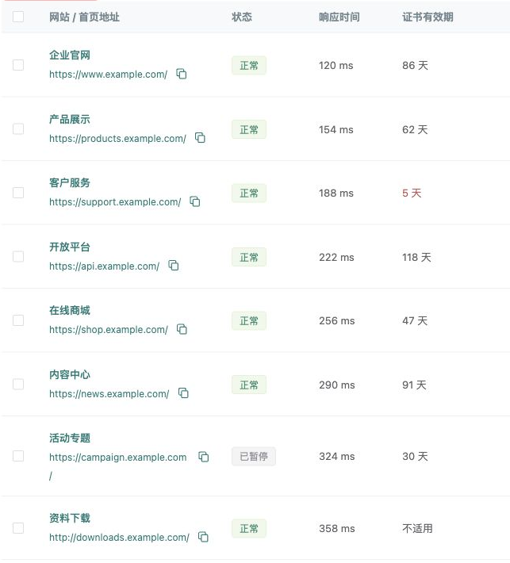
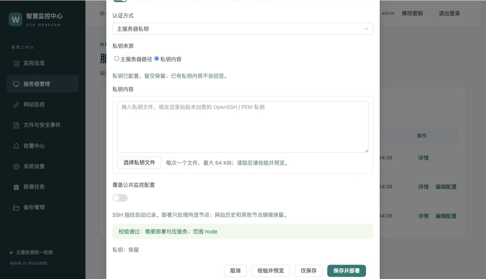
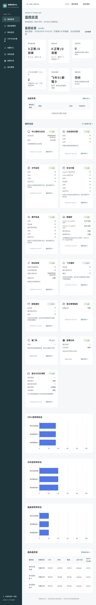

# DZH Webscan · 网站与服务器统一监控

监控多台服务器的网站文件变化、可疑代码、首页访问故障、证书到期和服务器资源，通过飞书和邮箱发送提醒，在自己的中文后台查询状态与历史。

[GitHub · gzdzh-cn/dzh-webscan](https://github.com/gzdzh-cn/dzh-webscan) · [当前版本 v2.0.38](https://github.com/gzdzh-cn/dzh-webscan/releases/tag/v2.0.38) · [Docker Hub central](https://hub.docker.com/r/gzdzh/webscan-central) · [Docker Hub agent](https://hub.docker.com/r/gzdzh/webscan-agent)

支持 **Linux amd64（x86_64）**。前端 Vue 3 + Vite + TypeScript + Element Plus + ECharts，构建后嵌入 GoFrame；服务器无需 Go、Python、Node.js 或前端容器。默认使用 Docker Hub 公开镜像 `latest`。

## 功能与文档

| 功能／菜单 | 当前能力与详细教程 |
|---|---|
| 监控总览 | 六组摘要、当前异常、13 类组件状态、CPU／内存／磁盘排名，每 30 秒刷新；[后台指南](docs/CONSOLE.md) |
| 服务器管理 | 主／子服务器资源、事件投递与主服务器中心健康；详情返回保留列表筛选；全后台共 17 个图表位置；[指标与切换](docs/CONSOLE.md#图表及服务器切换) |
| 网站监控 | 首页、关键词、慢响应、证书剩余天数与到期前 7 天提醒；网址复制、新标签打开、单站故障历史；[网站教程](docs/WEBSITE.md) |
| 文件与安全事件 | 多目录文件变化、YARA／可选 ClamAV 扫描；手动查询、默认隐藏探针、可选自动刷新；[监控规则](docs/MONITOR-RULES.md) · [查询与刷新](docs/RETENTION.md#查看与查询) |
| 告警中心 | 当前异常、告警历史、飞书通知、邮箱通知四个页签；双通道独立投递与重试；[邮箱配置和历史](docs/EMAIL.md) |
| 可视化节点配置 | 添加／编辑子服务器，选择 native／Docker、私钥路径／拖入文件／粘贴内容，预览后保存或部署；[节点表单](docs/CONSOLE.md#添加和修改子服务器) |
| 系统设置 | 必要 YAML 参数、飞书／邮箱、历史期限；预览、仅保存或应用；[配置参数](docs/PARAMETERS.md) |
| 部署任务 | 持久化任务与日志、继续／回退、符合保护条件的历史删除；[维护流程](docs/OPERATIONS.md) |
| 备份管理 | 网站配置／部署配置两个页签，手动备份、导入／导出和恢复预览；[备份、恢复与删除](docs/BACKUPS.md) |
| 账号与历史管理 | 持久化管理员密码；独立保留期限、自动清理、JSONL 导出、清理预览与审计；[账号](docs/WEBSITE.md) · [历史管理](docs/RETENTION.md) |
| Go 一体化 | 中心内置指标、告警和查询；子服务器一个 Agent，支持无需 Docker 的 systemd 服务；[中心迁移](docs/MIGRATION.md) · [节点部署](docs/NODE-DEPLOYMENT.md) |

网站关联节点只用于分类，首页检查由主服务器执行；文件监听与扫描在子服务器执行。目标规模为 **50 台服务器（含主服务器）、1000 个网站**。

## 统一监控面板



后台侧栏为：**监控总览、服务器管理、网站监控、文件与安全事件、告警中心、系统设置、部署任务、备份管理**。原“系统健康”进入主服务器详情的“中心健康”，原“网站故障历史”进入告警中心，单站历史仍在网站详情。

服务器管理点击名称或“详情”进入资源指标与事件投递页签，主服务器另有中心健康。顶部切换服务器保留时间范围，清空旧磁盘／网卡条件；标题栏“返回服务器列表”与网站详情风格一致，并恢复进入前的搜索和状态筛选。[页面和图表说明 →](docs/CONSOLE.md)

### 如何打开，需要什么端口

开启 `central.website_monitor.enabled`，部署完成后按实际 SSL 设置访问：

| 方式 | 地址 | 开放要求 |
|---|---|---|
| HTTPS 直接访问 | `https://主服务器IP:19444/login` | 云安全组与宝塔／系统防火墙放行 TCP 19444，需信任部署 CA |
| HTTP 直接访问 | `http://主服务器IP:19444/login` | 同上，协议使用 HTTP |
| 宝塔 HTTPS 域名反代 | `https://monitor.example.com/login` | 对外开放 443；同机后台绑定 127.0.0.1 时不开放公网 19444 |

端口以 `central.website_monitor.host_port` 为准。反代保留原域名 Host，并设置 `X-Forwarded-Proto $scheme`。[登录及宝塔配置 →](docs/WEBSITE.md#宝塔域名反向代理)

管理员初始凭据见安装结果；修改密码后新密码在升级、重启和保留数据的重装后保持。后台旧配置省略时默认关闭，新示例开启。

## 安装方式

**推荐 SH 自动部署**，统一配置各服务器并完成验收。选择其中一种：

1. **[SH 自动部署（推荐）](#1sh-自动部署推荐)**：首次一行安装，以后输入 `webscan` 管理。
2. **[Docker Compose 手动部署](#2docker-compose-手动部署)**：本地生成包，各服务器执行 Compose。

### 1、SH 自动部署（推荐）

在 Linux amd64 主服务器 root SSH 终端执行：

```bash
bash -o pipefail -c 'curl -fsSL https://github.com/gzdzh-cn/dzh-webscan/releases/latest/download/install.sh | bash'
```

入口自动创建 `/root/webscan-deploy`，下载固定发布版本并校验 SHA256。填写首次向导、保存后选择菜单 **1、安装**。可先不加子服务器，以后从菜单 **4** 或后台添加。

以后在主服务器任意目录输入：

```bash
webscan
```

再次执行一行命令保留已有 YAML、账号和数据；有新版时只更新入口，进入菜单，不自动升级容器。配置丢失或有未完成任务时先恢复原任务。[完整 SH 教程、权限与重复执行处理 →](docs/INSTALLATION.md)

### 2、Docker Compose 手动部署

本地完整源码目录先配置并生成身份、证书和运行配置：

```bash
cp webscan.example.yaml webscan.compose.yaml
chmod 600 webscan.compose.yaml
# 填写真实服务器及飞书信息
go run ./cmd/compose --config webscan.compose.yaml --check
go run ./cmd/compose --config webscan.compose.yaml --output compose-deploy
```

把各服务器对应目录上传。主服务器在包目录执行 `docker compose pull`、`docker compose up -d`；Docker 节点只启动一个 Agent；native 节点生成 systemd 安装包。Go 一体化主服务器只启动 receiver，内部采集宿主机指标。[完整 Compose 教程与可视化接管 →](docs/COMPOSE.md)

## 新架构与旧系统升级

```text
文件变化 → 节点 Agent／扫描／SQLite → Go 批量投递与确认 → 中心 SQLite → 飞书＋邮箱／后台
主机指标 → 共享 Go Linux 采集 → 指标 SQLite／聚合 → Go 告警 → 飞书＋邮箱／资源图表
网站配置 → Go 定时首页与证书检查 → 故障历史 → 飞书＋邮箱／后台
后台设置 → Unix Socket 宿主机管理服务 → YAML 备份／部署引擎 → SSH 与验收
```

**新示例采用 Go 一体化模式**，不启动 Prometheus、Alertmanager、Grafana、Loki；子服务器整合为一个 Agent，主服务器内部采集主机指标。旧 YAML 默认 legacy，先升级主服务器，然后后台迁入项目历史并验收，再停用本项目的四个旧容器；不直接删除旧数据。[迁移与回退教程 →](docs/MIGRATION.md)

这是固定项目指标和事件查询，不提供任意 PromQL／LogQL 或 Grafana 插件。旧系统仍在 legacy 时，可继续使用[Grafana 指南](docs/GRAFANA.md)。[详细执行顺序 →](docs/ARCHITECTURE.md)

## 近期功能更新（v2.0.34～v2.0.38）

本节于 **2026 年 10 月 14 日** 汇总近期后台更新，当前发布版本为 **v2.0.38**。完整变更按版本保存在[版本记录](docs/CHANGELOG.md)。

| 版本 | 主要更新 | 详细说明 |
|---|---|---|
| v2.0.38 | 私钥文件拖入／选择／粘贴，已有私钥留空保留；刷新时间只保留下拉框；详情返回按钮统一，总览去除重复标题；修复凭据“已配置”提示 | [私钥录入](docs/CONSOLE.md#子服务器私钥录入) |
| v2.0.37 | 两类备份统一入口、部署配置加密导入导出；网站及符合条件的记录单条／批量删除；子服务器卸载验收后移除 | [备份与删除保护](docs/BACKUPS.md) |
| v2.0.36 | 六组总览摘要、13 类组件状态；事件手动查询与可选刷新；独立保留期限、自动／手动清理、导出和存储统计 | [查询、保留与清理](docs/RETENTION.md) |
| v2.0.35 | 子服务器文件监控、扫描、指标和投递整合为一个 Agent；新增 native 部署，无 Docker 也可安装；中心内置主机采集 | [两种部署方式](docs/NODE-DEPLOYMENT.md) |
| v2.0.34 | 重复菜单整合、服务器详情返回及筛选清除修复；SMTP 发件配置、多收件人、飞书＋邮箱独立通知与历史 | [邮箱教程](docs/EMAIL.md) |

### 子服务器与私钥文件录入

**服务器管理 → 添加子服务器／编辑配置**：选择“直接运行 Go（无需 Docker）”或“Docker 单容器”。新增节点默认 native，由主服务器通过 root SSH 下发程序和工具，使用 systemd 常驻；主服务器仍需要 Docker。启用 ClamAV 时需节点已有扫描服务。[平台要求和部署保护 →](docs/NODE-DEPLOYMENT.md)

选择“主服务器私钥”认证后，私钥来源可选 **主服务器路径** 或 **私钥内容**。将本地文件拖入内容区，或点击“选择私钥文件”、直接粘贴，浏览器读取内容填入文本框，支持检查和修改。每次一个文件，最大 **64 KiB**，支持未加密 OpenSSH／PEM 私钥；已有私钥不回显，留空保留。

“校验并预览”不写文件、不连接节点；“仅保存”或“保存并部署”将私钥写入主服务器 `/var/lib/webscan-deploy/ssh-keys/`，目录 `0700`、文件 `0600`，YAML 只保存路径。替换保留旧文件供恢复使用；配置包不附实际私钥文件，灾备需另行安全保存。[完整操作 →](docs/CONSOLE.md#子服务器私钥录入)



### 事件查询、刷新与监控总览

**文件与安全事件首次进入、刷新或带参数进入均不自动查询**。设置服务器、事件类型、关键词和时间后点击“查询”或按回车；清除服务器后再查询，恢复其他条件下全部服务器的记录。修改条件保留上次结果并提示待提交，翻页使用已提交条件。链路探针默认隐藏，可勾选“包含链路探针”后查询；实际异常仍可查看。

查询成功后可开启自动刷新，每次进入默认关闭。下拉框提供 **10／30／60／120／300 秒**，默认 30 秒；间隔偏好在浏览器按用户名保留。待提交筛选或后台标签会暂停，自动刷新按已提交条件保留分页；刷新间隔只影响页面查询。告警中心沿用自动查询。

总览每 30 秒刷新，展示服务器、网站、当前异常、24 小时文件／安全事件、双通道待投递和部署任务六组摘要，以及 **13 类组件状态**；缺失数据标为未知。资源表补充运行方式、Agent 版本和采集时间。



### 邮箱通知、备份与历史管理

**系统设置 → 邮箱通知**绑定 SMTP 发件配置与接收邮箱，默认关闭，最多 20 个接收邮箱。支持 **465 + TLS／587 + STARTTLS**，预览并应用后可主动发送测试邮件；主服务器只需出站访问 SMTP。飞书和邮件独立限流、重试，每个收件人分别记录结果。**告警中心 → 邮箱通知**查看历史、重试及最近 7 天统计；“已提交邮件服务器”不代表进入收件箱或已读。[配置教程 →](docs/EMAIL.md)

**备份管理 → 网站配置／部署配置**均支持手动备份和导入导出。网站 JSON 恢复按网址合并，保留其他网站及历史；部署 YAML 默认脱敏导出，含凭据的 age 加密包仅支持 HTTPS 后台，导入仅加入备份列表，恢复预览后保存为待应用配置。配置备份不包含监控数据库、故障历史和当前管理员密码。[恢复与灾备 →](docs/BACKUPS.md)

**系统设置 → 历史与备份**独立设置普通事件、安全命中、已结束网站故障、服务器告警及通知期限，支持 **1～3650 天**。存储与清理可查看数据库／WAL 大小、预览、导出 JSONL 和手动清理；缩短期限可能自动删除历史，调大不能找回。SQLite 删除后的空闲页复用，文件不一定立即缩小。[期限与保护 →](docs/RETENTION.md)

网站为软删除；历史、通知、部署任务和备份提供符合保护条件的单条／当前页批量删除。最近 24 小时历史、当前异常、未结束故障、未完成投递及恢复／回退依赖受保护，不能勾选的记录显示原因；无依赖备份不受 24 小时限制。子服务器先卸载监控并验收，再移除配置，关联网站继续由中心检测，业务与历史数据保留。**系统设置保留期限与存储清理入口，不提供列表删除按钮。** [各页面规则 →](docs/BACKUPS.md#单条与批量删除)

### 已安装用户升级

已完成 v2.0.35 子服务器整合的用户，v2.0.36～v2.0.38 **只需升级主服务器**，沿用已有账号、网站、历史和通知队列：

```bash
webscan --upgrade --central-only
```

尚未完成 v2.0.35 的旧节点整合，执行完整升级，先更新中心再逐台更新启用节点：

```bash
webscan --upgrade
```

新增节点或主动切换 native／Docker 时，通过节点表单保存并部署。仅保存 YAML 标记待应用；下载部署包或更新 `latest` 不会自动切换运行服务。旧 legacy 系统先按[迁移教程](docs/MIGRATION.md)完成历史迁入和架构切换。

## 网络与维护

| 服务器 | 默认 TCP 端口 | 谁访问、做什么 |
|---|---|---|
| 主服务器 | 19443 | 子服务器上报文件事件 |
| 子服务器 | 19100 | 仅主服务器采集指标 |
| 子服务器 | SSH 端口，默认 22 | 主服务器部署和维护 |
| 主服务器 | 19444 | 管理后台，限制管理来源；同机反代可绑定回环地址 |
| 宝塔反代 | 443 | HTTPS 域名后台 |
| 旧 legacy 主服务器 | 3000 | Grafana；迁移完成后无需开放 |

云安全组和系统防火墙都要放行；主服务器需出站访问被监控网站、飞书和镜像仓库；开启邮件时还需出站访问 SMTP（常用 465／587），不新增邮件入站端口。SSL 总开关统一控制通信、采集和面板，切换协议需部署所有启用节点。

```bash
webscan --upgrade                        # 完整升级
webscan --upgrade --central-only         # 仅升级主服务器，不切换协议
webscan --add-node --node node-example   # 单节点添加或更新
webscan --reload-rules                   # 支持的过滤规则热更新
```

`latest` 不会自动更新运行容器。恢复／回退要保持原版本、配置及范围，按任务日志操作。[维护与回退](docs/OPERATIONS.md) · [问题排查](docs/TROUBLESHOOTING.md)

## 其他文档

[配置参数](docs/PARAMETERS.md) · [版本记录](docs/CHANGELOG.md) · [v2.0.38 验证记录](docs/ACCEPTANCE-v2.0.38.md) · [本地开发与发布](docs/DEVELOPMENT.md) · [镜像仓库](docs/REGISTRY.md)

文档 IP、域名、凭据均为示例。下载命令以已发布 Release 为准；源码构建中的新功能需发布相应镜像后才在线上可用。发布或同步部署包不自动切换生产容器。
