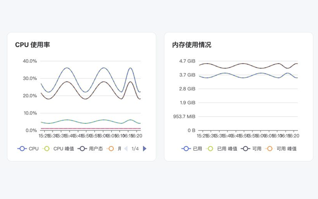
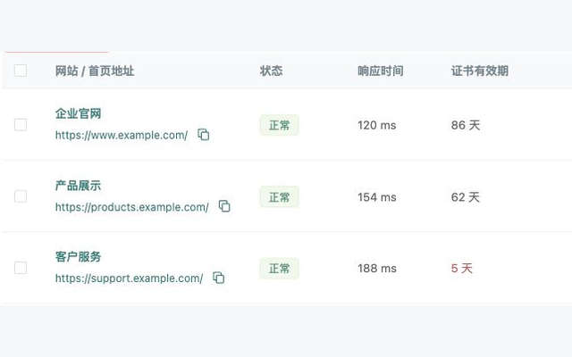
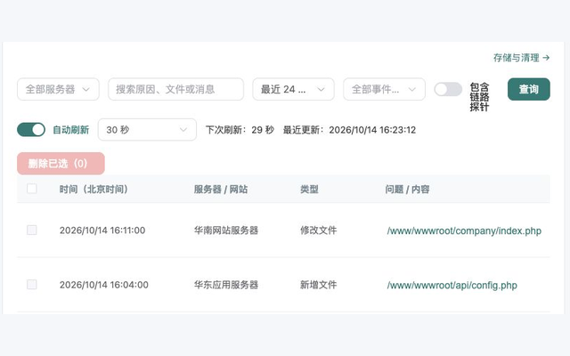
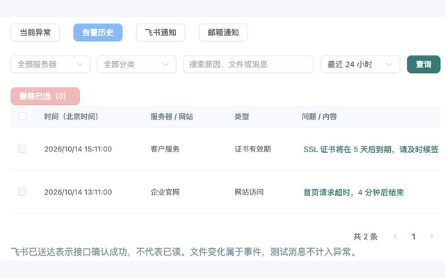
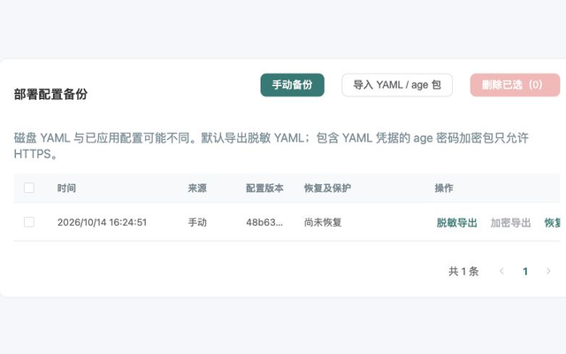
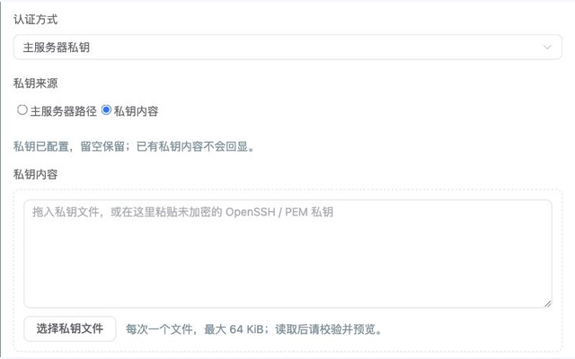

# DZH Webscan · 网站与服务器统一监控

一个中文后台，集中查看**服务器资源、网站访问、证书有效期和文件安全**。发现异常后，通过飞书和邮箱提醒，并保留可查询的故障与通知历史。

**源码版本 v3.0.0 · 单中心** · [GitHub 发布](https://github.com/gzdzh-cn/dzh-webscan/releases) · [v3 安装与升级](docs/V3-SINGLE-INSTALL.md) · [后台指南](docs/V3-CONSOLE.md) · [发布说明](docs/RELEASE-v3.0.0.md) · [验收记录](docs/V3-FORMAL-RELEASE-READINESS.md)

v3 主控主动采集子控，业务数据使用 PostgreSQL，指标使用 VictoriaMetrics。保留原版后台风格，接通网页安装、独立升级、任务日志和继续／回退；普通子控操作不重启主控。

新增主控、子控默认 Docker，native 保留可选。安装前确认 SSH 指纹，发布产物绑定源码、镜像摘要及签名；发布不会自动切换生产服务。

本次为单中心交付，不宣称通过高可用或万台容量认证。v2 旧数据迁移另行执行，不使用旧版升级命令自动迁入 v3。[网页部署与凭据](docs/V3-WEB-DEPLOYMENT.md) · [运行设置](docs/V3-SETTINGS-LIFECYCLE.md)

## 核心功能

| 关注什么 | 系统提供什么 |
|---|---|
| 服务器是否正常 | CPU、内存、磁盘、网络趋势；文件监控、扫描与事件投递状态 |
| 网站是否可用 | 首页访问、关键词、慢响应检查；证书有效期及到期前 7 天提醒 |
| 文件是否被修改 | 多目录文件变化记录、YARA／可选 ClamAV 扫描；手动查询与可选刷新 |
| 异常是否通知 | 飞书＋邮箱独立投递、失败重试、通知历史及发送结果 |
| 如何管理与恢复 | 可视化添加节点、只读连接检查、配置生效状态、部署阶段与原任务恢复；两类配置备份 |
| 历史如何保留 | 独立保留期限、自动清理、手动导出；受保护记录显示不可删除原因 |

主控与子控均使用 Go，支持 Linux amd64。主控通过双向 TLS 主动读取指标和事件；子控只运行一个 Agent，SQLite 保留待确认事件。支持 **Docker 单容器（默认）** 或 **systemd 直接运行**。[v3 架构与边界 →](docs/V3-RECONSTRUCTION.md)

v2.0.39 将采集、部署、配置生效状态分开展示，未完成任务可直接进入处理；节点表单明确公共规则继承，系统设置可查看待应用差异与实际构建版本。[配置与部署流程 →](docs/DEPLOYMENT-WORKFLOW.md)

## 界面展示

**监控总览：先看整体状态，再进入异常详情。**

[](docs/image/console-overview.png)

以下展示图按每行三张排列，点击可查看清晰原图。截图来自 v2.0.38 隔离演示环境，域名、IP 和记录均为示例。

<table>
  <tr>
    <td width="33%" align="center"><a href="docs/image/console-resources.png"></a><br><b>服务器资源</b><br>切换服务器，查看资源趋势</td>
    <td width="33%" align="center"><a href="docs/image/website-console.png"></a><br><b>网站监控</b><br>访问状态、证书天数与网址复制</td>
    <td width="33%" align="center"><a href="docs/image/console-events.png"></a><br><b>文件与安全事件</b><br>手动查询，需要时开启定时刷新</td>
  </tr>
  <tr>
    <td width="33%" align="center"><a href="docs/image/console-alerts.png"></a><br><b>告警中心</b><br>异常历史与双通道通知结果</td>
    <td width="33%" align="center"><a href="docs/image/console-backups.png"></a><br><b>备份管理</b><br>网站配置与部署配置分别恢复</td>
    <td width="33%" align="center"><a href="docs/image/node-private-key.png"></a><br><b>可视化节点配置</b><br>私钥支持拖入、选择文件或粘贴</td>
  </tr>
</table>

## v3 安装与打开后台

按 [v3 单中心安装与升级](docs/V3-SINGLE-INSTALL.md) 准备固定版本镜像、签名资料和独立数据目录。主控由应用容器、PostgreSQL 17、VictoriaMetrics 和宿主管理服务组成；安装完成后通过 HTTPS 后台管理子控。

浏览器访问主控 TCP 443；主控连接子控 SSH 实际端口及 TCP 19100。旧推送节点迁移完成前保留原 TCP 19443。已有试运行中心先预览升级，保留原 Vault 和数据库；v2 数据不自动导入。

## v2 安装与打开后台（旧版）

在 Linux amd64 主服务器的 root SSH 终端执行：

```bash
bash -o pipefail -c 'curl -fsSL https://github.com/gzdzh-cn/dzh-webscan/releases/download/v2.0.46/install.sh | bash'
```

按向导填写配置，保存后选择 **1、安装**。可先只安装主服务器，以后从后台添加子服务器。日常管理在主服务器任意目录输入 `webscan`；再次执行安装命令保留已有 YAML、账号和数据，只更新入口并进入菜单，不自动升级服务。[完整安装与重复执行说明 →](docs/INSTALLATION.md)

| 打开方式 | 默认地址与端口 |
|---|---|
| IP 直接访问 | `http://主服务器IP:19444/login` 或 `https://主服务器IP:19444/login`，与实际 SSL 设置一致；云安全组与防火墙放行 TCP 19444 |
| 宝塔 HTTPS 域名反代 | `https://monitor.example.com/login`；对外开放 443，同机后台可绑定 `127.0.0.1:19444` |

初始账号见安装结果；后台修改密码后使用新密码。子服务器默认还需 SSH 22、指标 19100；主服务器事件接收端口为 19443。[登录与宝塔反代](docs/WEBSITE.md#宝塔域名反向代理) · [全部端口及访问方向](docs/NODE-DEPLOYMENT.md#端口与安全)

## v2 已安装用户升级（旧版）

已完成 v2.0.35 节点整合的系统，更新当前后台只需升级主服务器：

```bash
webscan --upgrade --central-only
```

旧三容器节点尚未整合时执行 `webscan --upgrade`；旧 legacy 架构先按[迁移教程](docs/MIGRATION.md)迁入历史并切换。升级保留账号、网站和历史；发布镜像或下载部署包不会自动切换运行服务。[升级、继续任务与回退 →](docs/OPERATIONS.md)

## 详细文档

| 用途 | 阅读入口 |
|---|---|
| 日常使用 | [后台页面与图表](docs/CONSOLE.md) · [网站、证书与账号](docs/WEBSITE.md) · [邮箱告警](docs/EMAIL.md) |
| 数据管理 | [配置备份、恢复与删除保护](docs/BACKUPS.md) · [保留期限、导出与清理](docs/RETENTION.md) |
| 安装部署 | [SH 安装](docs/INSTALLATION.md) · [Compose 部署](docs/COMPOSE.md) · [native／Docker 节点](docs/NODE-DEPLOYMENT.md) |
| 维护排查 | [升级与回退](docs/OPERATIONS.md) · [旧系统迁移](docs/MIGRATION.md) · [常见问题](docs/TROUBLESHOOTING.md) |
| 专业配置 | [参数说明](docs/PARAMETERS.md) · [文件监控规则](docs/MONITOR-RULES.md) · [架构](docs/ARCHITECTURE.md) |
| 开发与版本 | [开发和发布](docs/DEVELOPMENT.md) · [镜像仓库](docs/REGISTRY.md) · [版本记录](docs/CHANGELOG.md) · [v2.0.38 验证记录](docs/ACCEPTANCE-v2.0.38.md) |

[Docker Hub central](https://hub.docker.com/r/gzdzh/webscan-central) · [Docker Hub agent](https://hub.docker.com/r/gzdzh/webscan-agent)
