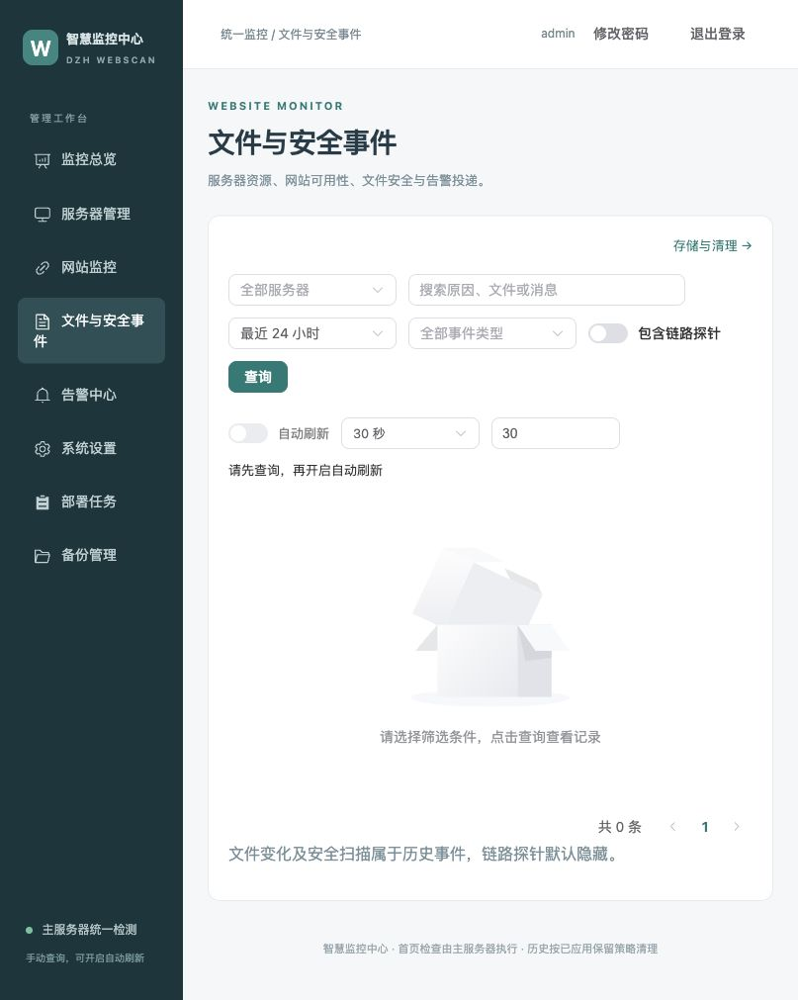

# v2.0.36 验证与发布记录

[返回 README](../README.md) · [历史保留与清理](RETENTION.md) · [后台指南](CONSOLE.md)

## 功能验收

| 范围 | 验证内容 |
|---|---|
| 文件与安全事件 | 首次进入、带参数、刷新和前进后退不请求历史；提交/清除/分页、过期响应保护；探针在总数与分页前排除，包括迁移数据 |
| 页面自动刷新 | 默认关闭、首次查询门槛、间隔校验、本地用户名隔离、待提交暂停、后台暂停恢复、失败重试及请求不重叠 |
| 监控总览 | 六组摘要、13 张组件卡、暂停网站、未知值、分区失败保留旧数据；390px 窄屏单列、无横向页面溢出 |
| 历史期限 | 旧自定义期限继承；独立安全、网站和服务器期限；1～3650 天整数校验 |
| 清理保护 | 未结束故障、当前服务器异常、未完成通知及收件人、有效租约、网站与服务器通知依赖；收件人及尝试记录联动删除 |
| 任务与导出 | 1101 条多批任务、互斥租约、跨数据库中断重放、重启续作、所有权、10 分钟凭据及配置版本、导出权限与字段白名单 |
| 失败场景 | 迁移前备份失败停止、磁盘受限导出失败、已完成部分可见、新增待投递保护、数据库不可用明确报错 |
| 页面实测 | 隔离后台真实点击查询、修改筛选暂停/提交恢复；清理预览、先导出门槛、JSONL 完成与下载入口；浏览器无控制台错误 |

前端使用与生产相同的 Element Plus 按需注册表进行测试，避免测试环境全量组件掩盖生产缺失。TypeScript、前端 27 项测试、Vite 构建及全量 Go 测试通过。测试只使用隔离数据库和测试账号，关闭飞书与邮件；没有向业务通知渠道发送测试消息。

清理使用短事务、最多 500 条一批、单批原始数据限制 4 MiB，每轮启动批次预算 2 秒；已开始的事务完成后让出执行。导出落盘采用分块进度、同步与原子重命名，重启不重复追加。SQLite 保留 WAL，不执行在线 VACUUM。

## 界面截图（隔离数据）





## 发布与升级

central 和 agent 的 v2.0.36 与 latest 已发布。匿名读取的版本/latest manifest 摘要一致，且 config ID 与本地 Linux amd64 镜像一致；保留 v2.0.35 回退资料。本次没有创建新的 GitHub Release。本版只升级中心，v2.0.35 Agent 保持兼容，无需升级子服务器。

```bash
webscan --upgrade --central-only
```

同步阶段只更新入口脚本和文档，保留实际 YAML、凭据、部署记录和当前生产容器。清理永久删除历史；缩短保留期限前请完成必要留档。

| 镜像 | v2.0.36 / latest 摘要 |
|---|---|
| central | `sha256:8c1c6274bed234c4f4bc51790232f4ccd08004fe3a1c18d6d6e7dce24eb82ad4` |
| agent | `sha256:ba3ae6f7257c78102adcc451bba6500ab9d0ca219b1b9c6879d5962cde35c94c` |

Linux amd64 镜像内运行了中心与历史清理测试，HTTP/HTTPS、会话与 CSRF 检查通过。隔离 v2.0.35 数据库升级验证管理员哈希指纹、网站、故障历史、文件事件、待投递任务及邮件收件人数量不变，两库迁移前一致性备份已生成，数据库完整性检查通过。中心与历史清理竞态测试通过。基线位于子服务器，本次不迁移子服务器数据库。

## 部署包同步核验

本地及主服务器 `deploy-webscan.sh` 已更新至 v2.0.36，README 同步完成；远端修改前备份位于 `/var/lib/webscan-deploy/package-backups/v2.0.36-20261014T020341Z`。同步前后实际 YAML、凭据、运行配置、部署状态校验值相同，两个生产容器的 ID、镜像及启动时间与宿主管理服务 PID 均相同。没有执行生产升级或重启服务。
