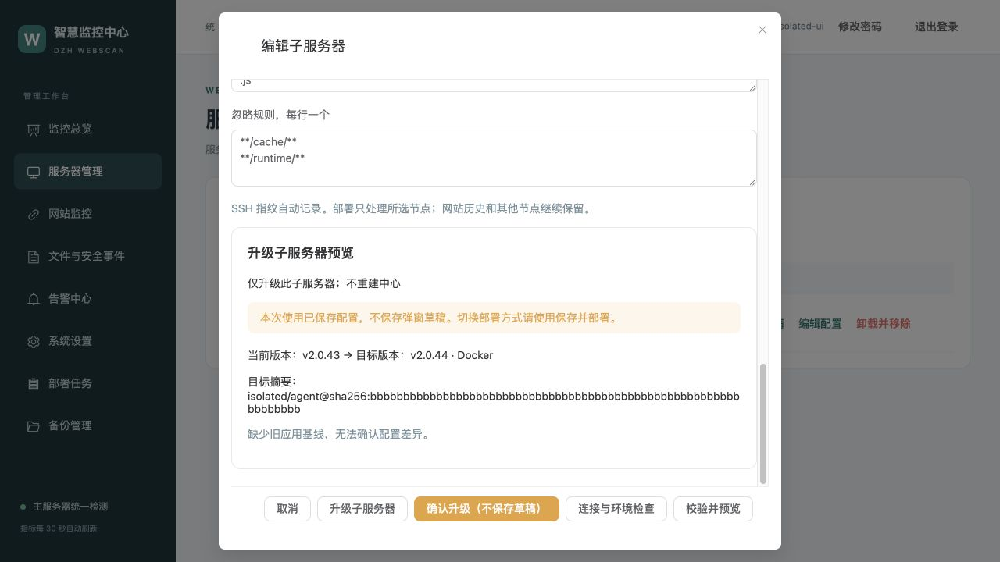

# v2.0.44 实现与验收

[返回 README](../README.md) · [后台指南](CONSOLE.md) · [部署流程](DEPLOYMENT-WORKFLOW.md)

开发阶段在 main 工作区实现、构建和隔离验证，没有连接或升级生产，也没有代为暂存、提交或推送 Git。原先用户已暂存的 v2.0.43 修改保留，新增修改留在工作区。先精确撤销旧会话草稿，再重新实现完整会话持久化。发布产物的版本、源码快照和镜像摘要以发布附件为准，源码提交由维护者完成。

## 实现范围

- 普通子服务器安装／更新通过内部受限接口热加载登记、来源限制、采集与维护状态；比较配置摘要，只有中心确认后继续启用事件投递。旧中心必须先升级，不自动重建中心作为兜底。
- 后台独立升级只使用已保存配置，10 分钟预览绑定账号、节点、配置、部署状态和不可变镜像摘要。任务与预览消费原子提交，继续任务继承原摘要。Docker／native 均复用原部署、备份与验收流程；部署方式变化不能借独立升级切换。
- `--upgrade --node ID`／`--install --node ID` 也进入节点范围，忽略中心未应用草稿。热加载失败及回退不主动重建中心。
- SQLite 会话只保存 Cookie SHA256、CSRF、账号版本、到期及创建时间；12 小时绝对到期，最多 100 条。退出删除本会话，改密和终端重置与全部撤销同事务完成。
- 只读网络请求遇到短暂断网、502／503／504 按 3 秒重连；写请求不重放。后台暂停、导航取消页面请求，登录探测不受初始路由取消影响；日志沿原游标续读。
- 添加／编辑弹窗正文内部滚动、标题和底部操作固定，窄屏单列与按钮换行；私钥拖入、选择和读取竞争保护保留。

## 已执行验证

- 前端类型检查、42 项测试和 Vite 构建。
- 全套 Go 测试；中心、部署、管理、网站、指标模块的 race 检查。
- 会话跨 Monitor／数据库连接恢复、固定到期、容量淘汰、退出与重置撤销、并发旧登录拒绝、撤销失败整笔回滚、迁移备份失败停止及数据库错误不冒充 401。
- 内部接口认证、公网不可访问、拒绝子服务器令牌、目标范围限制、配置冲突、503 保留快照、幂等确认与并发事件接收。旧采集请求返回后不能覆盖新节点配置。
- 部署模拟验证 native 登记、幂等重试和登记回退不调用 Docker；原节点维护状态保留。旧中心不支持时不改运行配置。
- 升级预览的账号／配置／状态／到期校验、拒绝 edit、摘要持久化和继续任务继承、重复提交防重、拒绝降级／模式切换，以及 Docker、native 的同版本同摘要无需升级判断。
- 本机 Docker Desktop **Linux amd64 隔离网络**运行新中心：新增登记、已有登记更新、登记回退前后容器 ID、PID 和 StartedAt 一致，原 Cookie 和 CSRF 可继续读写；新节点身份可接收事件，后台选项与采集调度生效。主动重启容器后原 Cookie 和 CSRF 仍有效。测试结束删除隔离容器和网络，不使用业务通知地址。
- 真实浏览器使用本地虚构节点验证独立升级预览。1280×720 弹窗正文可滚动、底部按钮可见；390×844 下单列表单和换行按钮可见，长预览可到达。截图为本地测试数据。

## 交付边界

测试容器登记更新不等于完整远端 Docker／systemd 安装验收；本次未执行完整远端 SSH 安装、扫描及业务节点升级，沿用既有节点安装、数据保护和扫描实现。发布只上传镜像和部署附件，不自动切换生产服务；生产升级需管理员另行执行并验收。

第一次正式升级中心需要重建中心，旧 v2.0.43 内存会话不能迁移，可能需要登录一次。后续普通节点操作使用免重建路径。中心版本、监听、协议、证书或挂载变化仍按专用部署流程处理。
