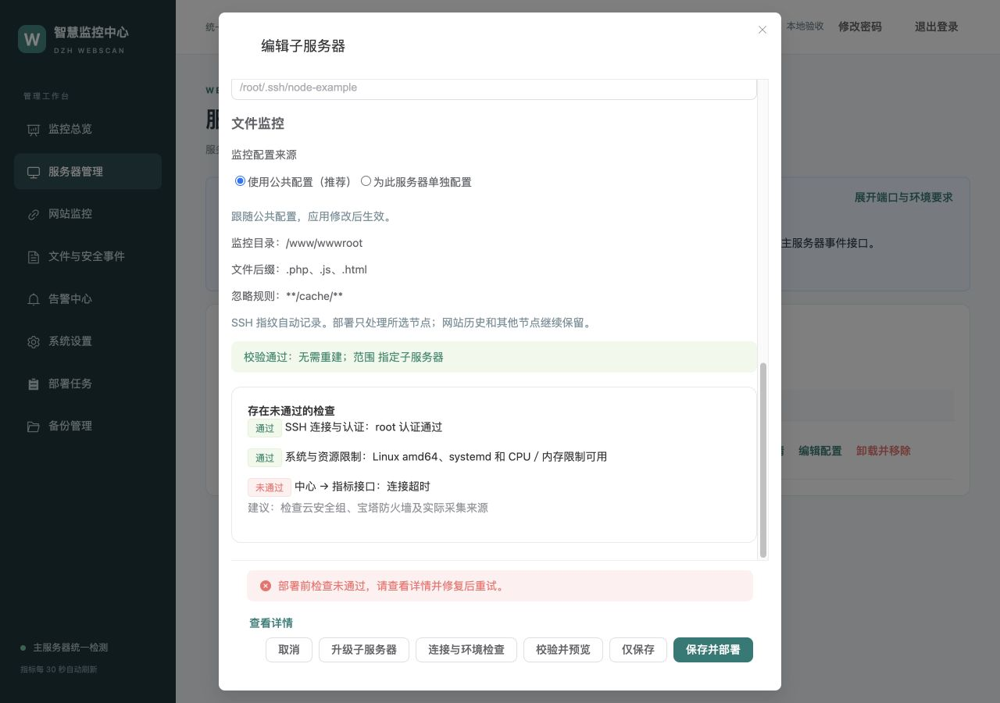

# v2.0.45 实现与验收

[返回 README](../README.md) · [后台指南](CONSOLE.md) · [部署流程](DEPLOYMENT-WORKFLOW.md)

## 功能

- 服务器列表顶部部署须知，添加／编辑弹窗简短摘要；展开后显示有效端口、事件地址、配置来源和环境要求，默认值与实际检测来源明确区分。
- 保存并部署及独立升级前异步检查 SSH／指纹、Linux amd64、工具、空间／inode／目录、资源控制、监控规则及 ClamAV。检查失败不保存草稿或创建部署任务，警告必须确认。
- 从中心实际采集网络访问指标，从子服务器访问事件 receipts 空查询，不生成业务事件。空闲指标端口运行校验 SHA256 和版本的临时 Go 程序，正常验证 TLS／双向 TLS；最长 90 秒，取消或断开后退出清理。其他服务占用时不终止原程序。
- 结果按账号、配置版本、节点、目标版本和部署状态绑定，有效 10 分钟；变更或管理服务重启后重查。正式切换前复核，扫描工具和规则在中心登记及停止旧服务前检查。CLI 只读检查不启动监听。
- 固定按钮附近显示进度、错误和结果，支持首个错误字段定位及详情入口；仅保存明确提示尚未部署，创建任务后进入日志。关闭重开弹窗忽略旧响应，普通节点操作不重启中心。

## 已验证

- 前端类型检查、49 项自动测试、Vite 构建；覆盖自动检查先于部署、失败保留输入、警告确认、独立升级不保存草稿、只读检查、取消迟到响应和错误字段焦点。
- 全部 Go 测试；管理、部署、中心和检测模块的竞态测试。覆盖检查结果绑定与失效、账号隔离、取消释放锁、失败不提交配置／私钥／任务，认证和公网限制。
- Linux amd64 隔离容器运行实际检测程序：HTTP、双向 TLS、缺少客户端证书拒绝、关闭标准输入退出及端口释放。测试使用临时证书与凭据，不连接业务通知。
- 真实浏览器配合隔离演示 API，在 1280×900 和 390×844 验证部署须知、固定错误提示、详情入口、首个错误字段焦点、仅保存列表反馈和系统设置持续反馈。



## 交付边界

测试未连接生产 SSH 或云安全组，未执行真实远端安装／升级，未修改防火墙、Nginx 或业务通知。云网络阻断位置不能仅凭超时确定；生产连接与完整安装仍按部署检查和验收确认。

发布镜像和部署附件不切换运行服务。启用新能力需要同时更新中心与宿主管理程序，首次更新中心会按原升级流程重建；无需单独升级子服务器，之后普通节点操作继续使用受限动态登记。

```bash
webscan --upgrade --central-only
```
