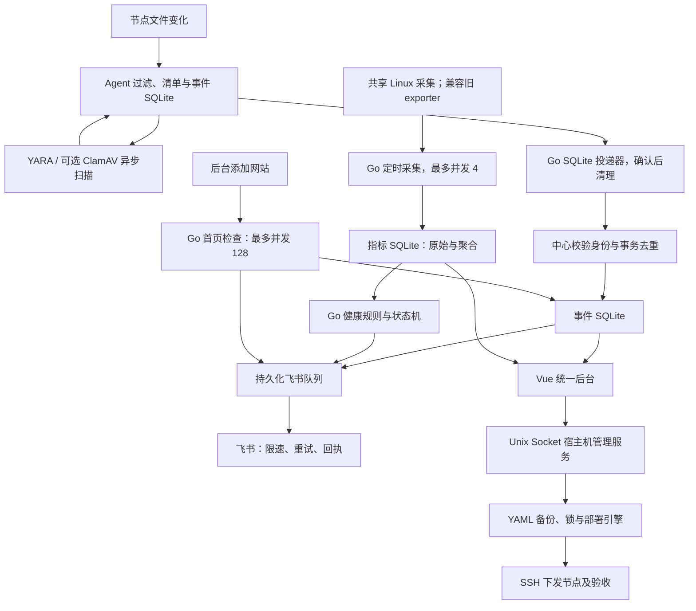

# 架构与执行顺序

[返回 README](../README.md) · [统一后台](CONSOLE.md) · [旧系统迁移](MIGRATION.md)

## 组件与职责

| 位置 | 组件 | 职责 |
|---|---|---|
| 主服务器容器 | webscan-central | GoFrame 页面与 API、文件事件接收、网站检测、资源指标采集、告警判断、查询、飞书队列及备份 |
| 主服务器宿主机 | webscan-management | systemd 进程；安全读写 YAML、执行部署任务和 SSH、看门狗 |
| 子服务器 | 统一 Go Agent | inotify、基线、扫描、SQLite 缓存、批量投递、主机指标和 `/metrics`；systemd 或单容器 |

新安装使用 native 模式；旧配置默认 legacy，保留 Prometheus、Alertmanager、Grafana、Loki，升级后影子采集不发送资源告警。[完成历史迁移](MIGRATION.md)后才停用四个旧组件。

## 四条运行链路

### 文件变化

1. Agent 接收 inotify 变化，按目录、后缀和忽略规则处理，读取内容并与清单比较。
2. 保存事件，符合条件的新增／修改／移动文件加入异步扫描队列。删除不扫描。
3. 扫描结果作为独立关联事件导出；普通文件变化通知不等待扫描结束。
4. Agent 从 SQLite 读取未确认事件，每批最多 100 条并限制请求大小；携带节点令牌上报。失败指数退避，响应丢失查询 receipts，中心按原 ID 去重。永久拒绝的事件保留失败记录，不阻塞后续正常事件。
5. 中心事务保存文件事件和飞书任务，再返回接收回执；native 直接从事件库查询，不写 Loki。
6. 投递队列按通知开关、限速和重试发送，保存结果。节点断网后缓存并补传，清单定期复核遗漏。

接收回执只保证事件已持久化，不代表飞书已送达。“等待扫描”不代表扫描通过。

### 服务器资源与健康

1. Go 分散采集主服务器和各节点，超时 5 秒，最多 4 个并发，请求及指标维度有大小限制。
2. 使用相邻有效计数器计算 CPU、磁盘和网络速率，计数器重置或数据过期时留空。
3. 原始记录及计数器基线写入独立指标 SQLite；先提交 5 分钟聚合再按保留期清理原始值。
4. 健康状态、异常历史及告警出箱事务提交；持续阈值、两样本恢复、抑制和重复提醒由 Go 处理。
5. 固定分组消息通过现有飞书队列发送。旧 Alertmanager 的切换后重试被确认但不再生成消息。
6. 宿主机看门狗独立检查中心，中心停止时仍能处理自身通知；整机停止需外部监控。

### 网站检查

后台保存网站到 SQLite → 主服务器调度 GET → 检查状态、关键词、证书 → 保存结果与故障历史 → 连续失败／恢复判断 → 事务加入通知队列 → 页面查询。

网站关联节点只用于分类。检查不抓取内页、不运行 JavaScript；解析和每次跳转均限制为公网地址。默认 60 秒间隔、5 秒超时、失败 3 次与成功 2 次通知。证书不超过 7 天独立提醒。[完整网站规则](WEBSITE.md)。

### 配置与部署

后台或终端编辑 YAML → 类型与完整配置校验 → 文件版本冲突检查、配置备份与原子保存 → 预览范围 → 宿主机任务 → 既有部署引擎、SSH、阶段日志 → 验收与完成记录。

兼容参数热加载；过滤规则热更新；根目录挂载变更重建受影响节点；中心监听或内存变更重建中心；统一 SSL 切换更新主服务器和全部启用节点。后台容器仅连接 Unix Socket，不持有 Docker Socket 或 SSH 私钥。

## 默认文件位置

| 文件 | 内容 |
|---|---|
| `/root/webscan-deploy/webscan.yaml` | 配置源，root 0600；网站和密码不靠此文件覆盖 |
| `/opt/webscan-central/webscan-v1/runtime.json` | 部署生成的运行快照 |
| `/var/lib/webscan-central/events-v1.sqlite3` | 网站、账号、故障、文件事件和投递队列 |
| `/var/lib/webscan-central/metrics-v1.sqlite3` | 服务器指标、聚合、基线、健康状态和迁移检查点 |
| `/var/lib/webscan-deploy/management.sqlite3` | 部署任务、脱敏日志、配置备份元数据和看门狗状态 |
| `/var/backups/webscan` | 一致性数据库备份及网站配置备份 |
| `/etc/webscan-v1`（节点） | Agent／Vector 运行配置、规则、证书 |
| `/var/lib/webscan-v1`（节点） | 本地清单、事件及扫描任务 |

路径以实际配置为准。源 YAML 不会直接改变常驻服务，保存后需应用；网站增删改即时生效。

## v2.0.35 子服务器与主机采集

新增节点默认 native（systemd），旧节点未指定方式则沿用部署记录，旧三容器识别为 Docker。`central.monitoring.mode: native` 控制中心架构，与 `nodes[].deployment.mode` 控制节点运行方式是两个字段。容器只读挂载宿主机 proc/sys/root，读取 PID 1 的网卡和挂载信息；中心采集使用 `local://host`。旧 exporter 的指标仍可采集，以便逐台升级。

CPU、磁盘和网络使用累积计数与中心原有派生计算，首样本或计数重置不填零。采集器错误单独展示，其他指标继续使用。事件投递告警沿用旧链路告警身份，切换期间仅抑制当前维护节点。

[节点方式、扫描工具与无损切换](NODE-DEPLOYMENT.md)。
