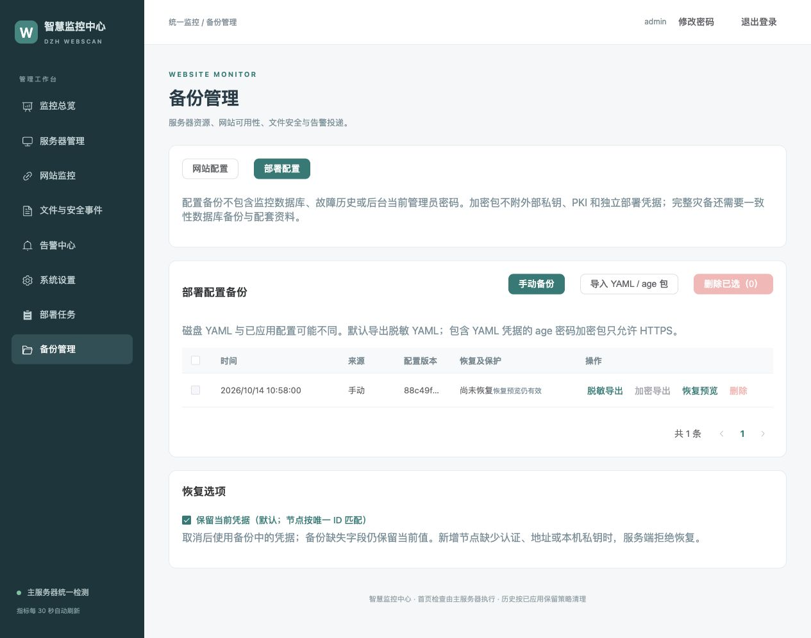
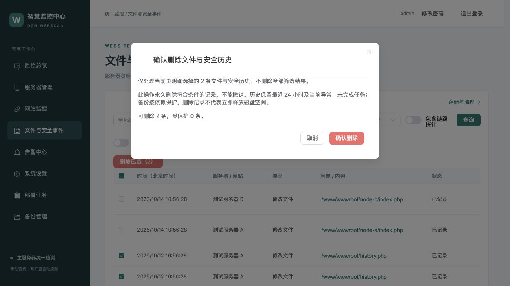

# 备份、恢复与删除

从侧栏 **备份管理** 进入；网站配置、部署配置分别分页。旧 `/config-backups` 地址自动进入部署配置页签。

| 类型 | 内容 | 恢复方式 |
|---|---|---|
| 网站配置 | 全部未删除网站的网址、名称、关键词、关联节点、慢响应开关、暂停状态 | 按规范化网址合并；其他网站保留，软删除的网站可恢复 |
| 部署配置 | 磁盘 YAML 中的服务器、规则、通知与部署参数，可能包含尚未应用修改 | 预览后保存为待应用配置，再到系统设置应用 |

两类配置备份均不包含监控数据库、故障历史或后台当前管理员密码。完整灾备需要一致性数据库备份、部署资料、PKI 和外部私钥。不要用配置恢复替代数据库恢复。

## 网站配置

一键备份保存所有正常及暂停的网站，不受筛选影响。JSON 导入上限 2 MiB、1000 个网站；导入仅加入列表，不立即修改网站。恢复先显示新增、更新、不变数量；未知节点关联清空，网站继续由主服务器检测。恢复前自动备份当前网站配置。

## 部署配置

手动备份保存当前磁盘 YAML。来源包括手动、编辑前、部署前、恢复前、导入；历史兼容指定备份目录内已有 YAML。

- 默认导出版本化脱敏 YAML，删除凭据、敏感地址和注释，并列出省略字段。不要把遮罩文本填成真实密码。
- 完整 YAML 凭据可导出为官方 `filippo.io/age` 库生成的标准 age 密码加密包。密码至少 12 字节，两次输入一致，不保存密码；丢失密码无法解密。
- 含凭据的加密导入、导出仅允许 HTTPS 后台，包括使用 HTTPS Nginx 反代的后台；HTTP 后台可脱敏导出。YAML 上限 2 MiB，加密包上限 4 MiB。错误密码有失败限流，解密限制并发和计算成本。
- 导入只加入列表，不覆盖 YAML 或执行部署。脱敏备份需核对补全；结构、版本、重复键和参数错误会拒绝。
- 恢复预览有效 10 分钟，绑定账号、备份摘要、当前配置版本与凭据选项。配置或选项变化后重新预览。
- 默认保留当前凭据；节点按唯一 ID 匹配。可以明确选择采用备份凭据，但备份缺失的字段仍保留当前值。新增节点缺少必需认证时不能恢复。
- 本机路径、数据目录、私钥不会随配置包迁移。主服务器实际使用的私钥须存在，且其他用户没有访问权限。
- 恢复前自动备份当前 YAML；失败不覆盖配置。未完成部署或卸载时禁止恢复；架构切换走专用迁移／回退流程。

文件位于服务器既有备份目录，目录 `0700`、文件 `0600`；后台不能指定任意服务器路径。配置包不附独立部署凭据文件、外部私钥和 PKI。后台录入的私钥同样只保存路径；实际文件位于主服务器 `/var/lib/webscan-deploy/ssh-keys/`，完整灾备或迁移时需另外安全保存该目录，保留 root 所有权及目录 0700、文件 0600 权限。

## 单条与批量删除

只处理当前页明确选择的记录；备份无依赖时不受 24 小时限制。历史保护最近 24 小时、当前异常、未结束故障、未完成扫描、待发送／暂停／重试任务、租约及通知顺序依赖。页面显示保护原因，服务端执行时再次校验。

| 页面 | 删除行为 |
|---|---|
| 网站监控 | 单条／批量软删除，取消检测并递增版本，保留历史及通知，不发送恢复通知 |
| 文件与安全事件 | 查询后删除选中且符合条件的历史；同步清除重复迁移展示记录；按已提交条件刷新 |
| 告警历史、飞书、邮箱通知 | 删除已完成且满足保护规则的历史；通知收件人与尝试记录一并处理，不撤回已发消息 |
| 部署任务 | 只删除完成超过 24 小时的页面记录及日志；保留防重元数据、实际部署状态及回退资料 |
| 两类配置备份 | 持久化任务删除文件与元数据；有效恢复预览、运行操作及回退依赖受保护 |
| 服务器管理 | 子服务器先卸载监控并验收，再移除配置；主服务器禁止移除 |

服务器批量最多 20 台，其他最多 200 条。服务器移除逐台执行，失败暂停后续节点；失败节点保留配置，已完成节点不重复卸载。任务详情可继续原范围。远端数据库、事件队列、业务目录、Docker 引擎及其他容器保留；关联网站转由中心检测，故障历史保留原节点身份。

当前异常、监控总览不增加删除。**系统设置没有新增单条／批量删除按钮**，原有保留期限和“存储与清理”继续使用。清理、导出与删除审计只读，保留 365 天；删除记录不意味着 SQLite 文件立即缩小，空闲页可复用，不执行在线 VACUUM。

