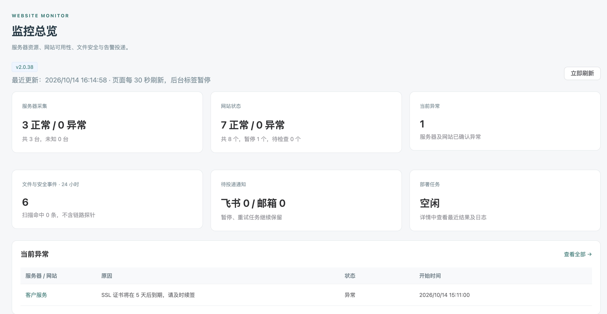
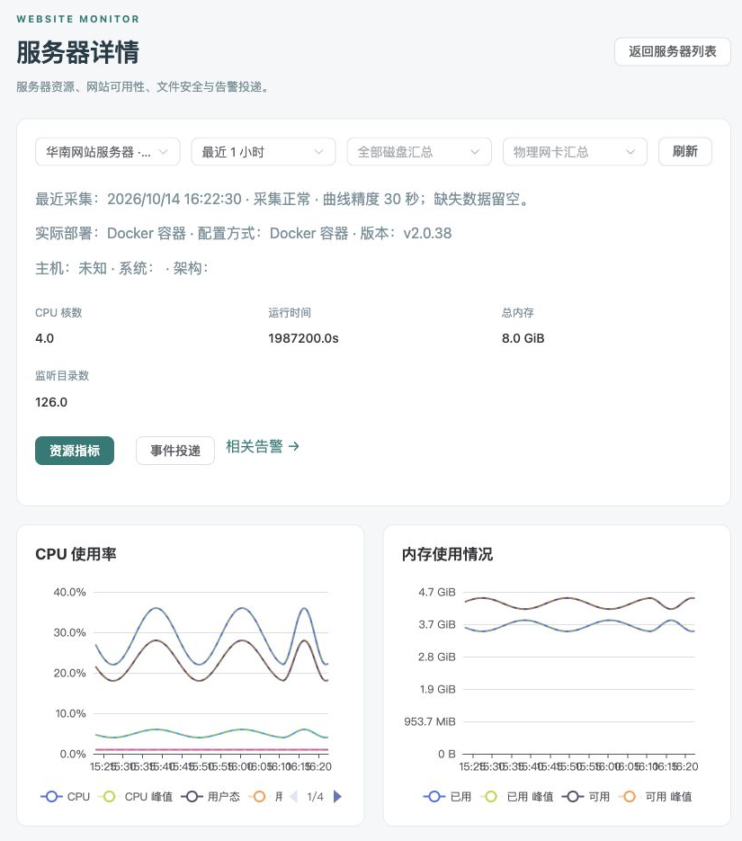
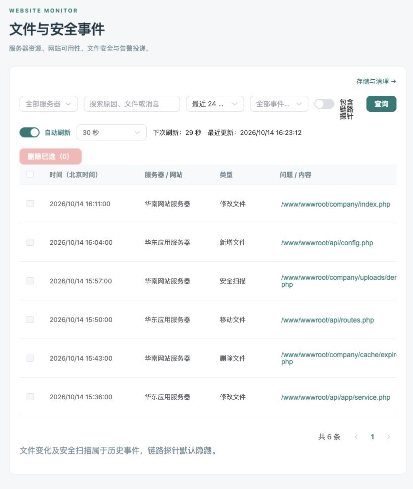
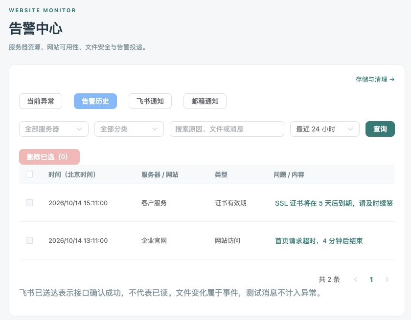
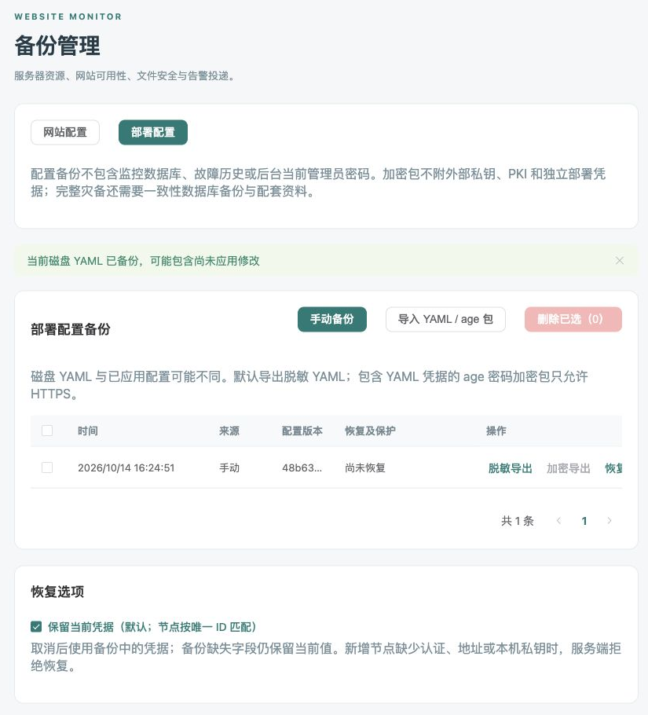

# 监控后台使用指南

[返回 README](../README.md) · [安装教程](INSTALLATION.md) · [网站与账号](WEBSITE.md) · [配置参数](PARAMETERS.md)

本页按操作场景介绍当前 v2.0.38 后台。截图来自隔离演示环境，使用示例域名、IP 和记录；点击图片可查看原图。

[进入后台](#进入后台) · [监控总览](#监控总览) · [服务器与图表](#图表及服务器切换) · [网站监控](#网站监控) · [文件事件](#文件与安全事件) · [告警通知](#告警与通知记录) · [添加节点](#添加和修改子服务器) · [私钥录入](#子服务器私钥录入) · [系统设置](#修改-yaml-参数) · [备份与删除](#备份与记录删除)

## 进入后台

安装完成后，使用终端显示的网站后台地址和初始账号登录。后台默认端口 **19444**；实际地址、协议及端口以已应用配置为准。后台改密后使用最新密码，升级不会重置账号。

| 访问方式 | 示例 | 需要放行 |
|---|---|---|
| HTTP 直接访问 | `http://主服务器IP:19444/login` | 云安全组与系统／宝塔防火墙的 TCP 19444 |
| HTTPS 直接访问 | `https://主服务器IP:19444/login` | TCP 19444；客户端需信任部署 CA |
| 宝塔 HTTPS 域名反代 | `https://monitor.example.com/login` | 对外 TCP 443；同机后台绑定回环地址时无需公网开放 19444 |

域名反代应保留浏览器 Host，设置 `X-Forwarded-Proto $scheme`，代理地址的协议应与后台实际协议一致。具体配置与“请求来源不正确”排查见[宝塔反代教程](WEBSITE.md#宝塔域名反向代理)。

## 页面导航

| 页面 | 主要用途 |
|---|---|
| 监控总览 | 整体状态、当前异常、组件状态及资源排名 |
| 服务器管理 | 服务器列表、资源／投递详情、添加和编辑节点 |
| 网站监控 | 网站状态、证书有效期、配置及单站故障历史 |
| 文件与安全事件 | 手动查询文件变化、扫描及监控运行记录 |
| 告警中心 | 当前异常、告警历史、飞书通知、邮箱通知 |
| 系统设置 | 参数、通知和保留期限的预览、保存、应用 |
| 部署任务 | 部署进度、日志、继续与回退 |
| 备份管理 | 网站配置／部署配置的备份、导入导出和恢复 |

旧“系统健康”在主服务器详情的“中心健康”；旧“网站故障历史”在告警中心。旧 `/health`、`/incidents`、`/config-backups` 链接继续跳转到对应入口。

## 监控总览

先看六组摘要：服务器采集、网站状态、当前异常、最近 24 小时文件／安全事件、双通道待投递和部署任务。暂停网站单独统计，事件摘要排除链路探针。

下方有 **13 类组件状态**：中心接收与后台、主机指标采集、文件监控、安全扫描、事件投递、网站检测、数据库、飞书通知、邮箱通知、宿主管理服务、看门狗、备份与历史清理、部署任务。每卡提供原因、时间及详情入口。

状态文字区分正常、异常、未知、已停用、未接管、维护中。缺少证据不显示正常，关闭的组件显示已停用；进入文件事件页只预填筛选，仍需点击查询。

总览每 **30 秒**刷新，后台标签暂停，返回后更新；分区读取失败保留上次数据并标注过期。CPU／内存／最满磁盘排名及服务器资源表用于快速定位需要查看的服务器。

## 图表及服务器切换

服务器管理点击名称或“详情”，进入同一详情页。标题栏 **返回服务器列表** 恢复进入前的搜索和状态筛选；直接打开详情时返回默认列表。

| 页签 | 显示内容 | 适用服务器 |
|---|---|---|
| 资源指标 | 主机信息、CPU、内存、磁盘和网络图表 | 全部 |
| 事件投递 | 心跳、覆盖、积压、最老等待、最近确认及投递检查 | 全部 |
| 中心健康 | 数据库、队列、管理服务和看门狗 | 仅主服务器 |

顶部下拉切换服务器，保留时间范围和有效页签，清空旧磁盘／网卡选择；从中心健康切到子服务器时进入事件投递。磁盘／网卡清除恢复汇总。详情地址为 `/servers/节点ID`，可收藏或分享给已登录的管理员。

后台共 **17 个图表位置**，按所在页面加载：

| 页面 | 图表 | 数量 |
|---|---|---|
| 总览 | CPU、内存、最满磁盘使用率排名 | 3 |
| 资源指标 | CPU、内存、Swap、负载、磁盘空间、inode、读写速率、IOPS、网络收发、网络错误与丢包 | 10 |
| 事件投递 | 待投递／待扫描数量；心跳与投递检查延迟 | 2 |
| 飞书通知 | 最近 7 天通知结果 | 1 |
| 邮箱通知 | 最近 7 天收件人投递结果 | 1 |

[查看 10 个资源图表完整截图 →](image/console-resources-full.png)

时间可选最近 1 小时、6 小时、24 小时、7 天或自定义，范围最多 90 天，实际可查范围由保留期决定。默认原始指标保留 48 小时，5 分钟聚合保留 15 天，保留均值和峰值。缺失曲线留空，磁盘空间和 inode 使用最近样本；首个计数样本、重启和计数重置不会伪造速率。

网络默认汇总物理网卡，排除 lo、veth、docker 和 br- 接口。指标页面每 30 秒刷新，后台标签暂停。采集由 Go 完成，新架构不要求独立 Vector 或 node-exporter，旧节点指标兼容保留。

## 网站监控

网站列表显示访问状态、响应时间、证书有效期、最近检查及关联服务器。**名称进入详情；网址在新标签打开；旁边图标复制完整网址。** HTTP 后台也提供复制兼容方案。

首页及证书由主服务器检查，关联节点用于分类。证书剩余时间不超过 7×24 小时开始提醒，进入过期状态补发，续签后恢复；网络失败保留最近证书信息，不误报恢复。

单站详情保留故障时间及持续时长。“已结束”也可能是暂停或编辑导致，不应仅据此认定网站恢复。右上角“修改密码”持久化新密码并撤销全部会话。[网站检测、证书与账号详细说明 →](WEBSITE.md)

## 文件与安全事件

**首次打开、刷新、带参数进入和前进后退均不自动查询记录。** 默认最近 24 小时，每页 20 条，先设置服务器、类型、关键词和时间，再点击“查询”或在搜索框按回车。

修改或清除筛选只更新待查询条件，保留上次结果并提示“点击查询更新”；翻页使用已提交条件。清除服务器后点击查询，恢复其他条件下所有服务器记录。空结果与接口失败有不同提示。

链路探针默认隐藏；需要查看时勾选“包含链路探针”再查询。隐藏不停止检测或保存，也不隐藏真实的投递失败、监控异常和覆盖不足。

查询成功后才能开启 **自动刷新**。下拉选择 **10、30、60、120、300 秒**，默认 30 秒，不再另设自定义数字输入框。每次进入页面默认关闭，间隔偏好在浏览器按账号保留。

自动刷新使用已提交条件并保留分页；修改筛选后暂停，手动查询成功后继续。后台标签暂停，返回时更新；请求不重叠，失败保留上次数据并标注。**刷新间隔只影响页面查询，不改变网站检测或 Agent 采集周期。** [保留期限、导出与清理 →](RETENTION.md)

## 告警与通知记录

告警中心提供 **当前异常、告警历史、飞书通知、邮箱通知**四个页签；沿用自动查询，不受文件事件手动查询规则影响。

告警历史按全部／网站／服务器分类。网站一次故障一行，显示开始、结束及持续时间；服务器保留触发、提醒、恢复各条事件，触发和提醒的时长为“截至本条事件”。当前异常不允许直接删除。

飞书和邮箱独立限流、重试；邮箱每个收件人分别记录结果。飞书“已送达”表示接口确认成功；邮件“已提交邮件服务器”不表示已进收件箱或已读。通知详情可查看尝试次数、下次重试及脱敏原因。[配置邮箱与测试邮件 →](EMAIL.md)

CPU／内存告警默认关闭。CPU 默认超过 85% 持续 300 秒提醒、低于 80% 连续两次恢复；内存默认超过 90% 持续 300 秒提醒、低于 85% 连续两次恢复。缺失采样中断持续计时。节点不可达时抑制附属告警，新模式由 Go 判断，不重复使用 Alertmanager 通知。

## 添加和修改子服务器

1. **服务器管理 → 添加子服务器／编辑配置**，填写名称、唯一 ID、IP 和 root SSH 端口。
2. 选择“直接运行 Go（无需 Docker）”或“Docker 单容器”；新增默认 native，已有节点按部署记录沿用原方式。
3. 选择密码或主服务器私钥认证，已有凭据留空保留；SSH 主机指纹自动记录并持续校验。
4. 默认继承公共监控目录与规则。覆盖时数组整体替换，可先“复制公共配置”再追加。
5. 点击“校验并预览”，检查影响后选择“仅保存”或“保存并部署”。关闭浏览器不取消部署任务。

native 需要 root SSH、Linux amd64、systemd 和 CPU／内存 cgroup，无需 Docker。Docker 模式复用现有引擎；服务异常不会重装或重启其他业务容器。启用 ClamAV 时要求节点已有扫描服务。[平台要求、切换保护和端口 →](NODE-DEPLOYMENT.md)

仅保存标为待应用。新增节点沿用主服务器当前运行设置和锁定镜像，不顺带应用其他 YAML 改动。停用不自动卸载；卸载移除需主动提交对应操作。节点 ID 和已有 IP 不能原地替换，更换主机请新增节点。

## 子服务器私钥录入

已保存但尚未部署、或部署后已回退的节点仍保留在服务器列表，显示“待部署”或“已回退”，可从“编辑配置”校验后部署，无需再次添加。任务尚未完成时，进入“部署任务”的原任务详情选择“继续原任务”或“回退原任务”；继续沿用原节点范围和已安装主服务器设置。回退完成保留 YAML 节点配置，重新部署应编辑该节点。

选择“主服务器私钥”认证后，提供两种来源：

| 来源 | 填写方式 |
|---|---|
| 主服务器路径 | 主服务器宿主机上已有私钥的绝对路径 |
| 私钥内容 | 拖入本地文件、点击“选择私钥文件”，或直接粘贴到多行文本框 |

拖入和选择文件只读取内容并填入文本框，不把电脑路径当作主服务器路径，不自动保存或部署。每次一个文件，最大 **64 KiB**，不限制扩展名。支持未加密 OpenSSH／PEM 私钥；公钥、损坏文件和需要口令的加密私钥明确拒绝。编辑不回显私钥，留空保留；切换来源或关闭表单清除临时内容。

“校验并预览”不写文件、不修改 YAML、不连接节点。“仅保存”或“保存并部署”将私钥写入主服务器 `/var/lib/webscan-deploy/ssh-keys/`，目录 `0700`、文件 `0600`，YAML 只记录路径。替换时保留旧文件供原配置恢复；部署失败沿用原任务继续或回退。

**配置包不附实际私钥文件。** 迁移或完整灾备需另外安全保存受管理私钥目录、外部私钥和 PKI。[备份边界 →](BACKUPS.md)

## 修改 YAML 参数

系统设置读取当前磁盘 YAML，表单修改后先“校验并预览变更”。秘密字段不回显，留空保留；预览不显示凭据。保存前自动备份，有未完成部署时先处理原任务。

| 操作 | 结果 |
|---|---|
| 仅保存 | 原子写入 YAML，运行服务不变，标记待应用 |
| 保存并应用 | 根据预览范围热加载或重建；端口、目录、资源限制等按实际影响处理 |
| 升级镜像 | 主服务器终端执行 `webscan --upgrade` 或 `--central-only` |

SSL 总开关变化需要应用到中心和全部启用节点。其他管理员或终端修改过 YAML 时需重新读取和预览，旧配置不能覆盖新版本。后台密码和网站配置在 SQLite，不由 YAML 编辑覆盖。

邮箱通知默认关闭，支持 465 TLS／587 STARTTLS，最多 20 个收件邮箱。预览、保存并应用后，主动发送测试邮件并核对历史与收件情况；只需主服务器出站访问 SMTP。[邮箱教程](EMAIL.md) · [参数说明](PARAMETERS.md)

## 备份与记录删除

备份管理统一 **网站配置／部署配置**两个页签，独立分页：网站 JSON 恢复按网址合并；部署 YAML 恢复预览后保存为待应用配置。部署配置默认脱敏导出，含 YAML 凭据的 age 加密包仅支持 HTTPS 后台。

导入只加入备份列表，不立即覆盖或部署。配置备份不包含监控数据库、故障历史及当前管理员密码，完整灾备仍需一致性数据库备份和配套资料。[备份与恢复步骤 →](BACKUPS.md)

历史及通知支持符合条件的单条／当前页批量删除，最近 24 小时、当前异常、未完成投递和恢复依赖等记录受保护；不可勾选的记录显示原因。网站采用软删除。**系统设置不增加单条／批量删除按钮**，保留期限和存储清理入口继续使用。删除记录不代表 SQLite 文件立即缩小。[删除保护](BACKUPS.md#单条与批量删除) · [存储与清理](RETENTION.md)

## 宿主机管理服务

SH 部署安装 `webscan-management`，通过 root Unix Socket 执行 SSH、配置写入和部署；中心容器不挂载 Docker Socket 或 SSH 私钥。任务和日志持久化，中断后按原配置、版本和范围继续或回退。

看门狗每 30 秒检查中心，启动宽限 180 秒；连续 3 次失败故障、连续 2 次成功恢复，部署期间抑制通知。中心不可用而宿主机正常时仍可发送自身告警；整机断网或关机需要外部监控。

普通 Compose 查看页面不依赖管理服务，可视化部署需[显式接管](COMPOSE.md#启用可视化部署与配置管理)。[升级与回退](OPERATIONS.md) · [旧架构迁移](MIGRATION.md) · [版本记录](CHANGELOG.md)
