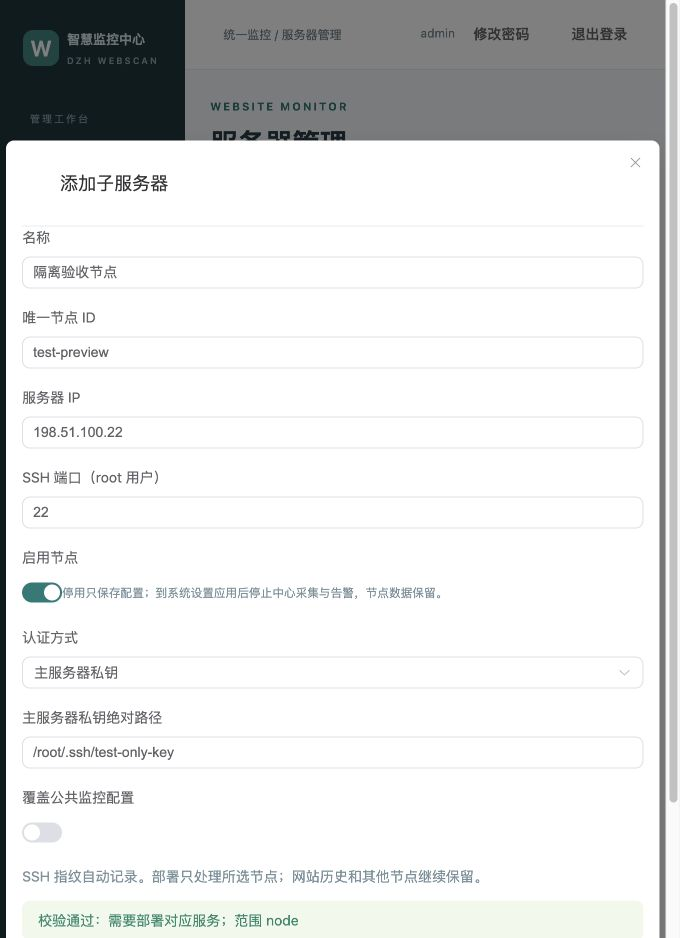
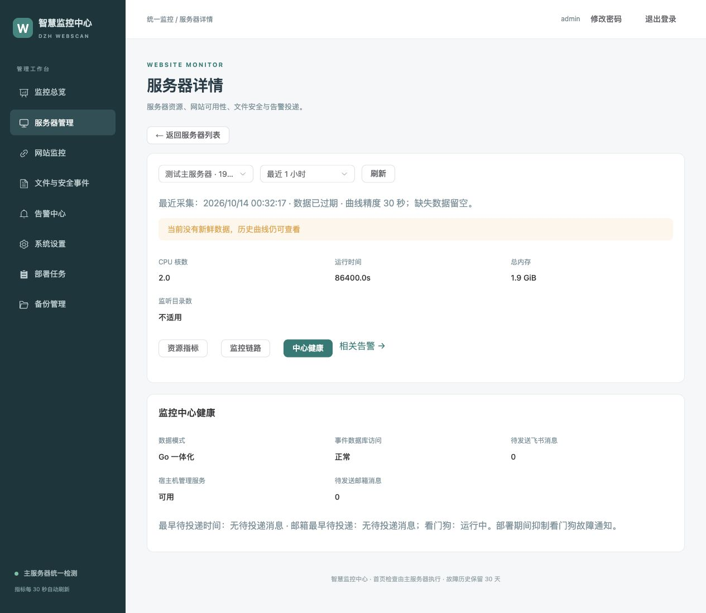
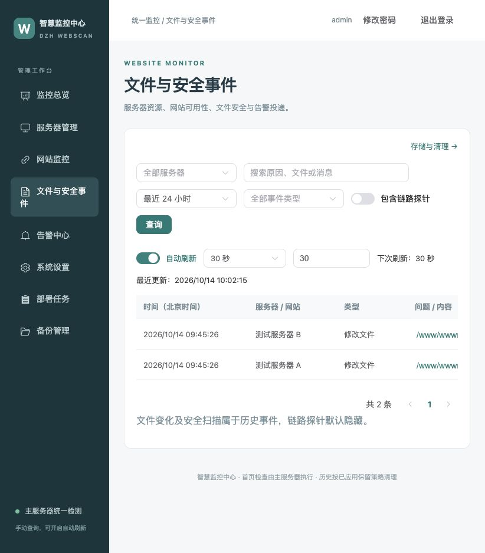
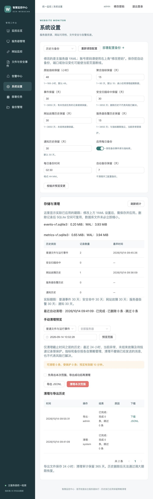

# Go 一体化监控后台

[返回 README](../README.md) · [网站检查、账号与备份](WEBSITE.md) · [安装](INSTALLATION.md) · [迁移旧系统](MIGRATION.md)

统一后台集中展示服务器资源、网站访问情况、文件与安全事件，以及飞书／邮箱投递结果。前端使用 Vue 3、Vite、TypeScript、Element Plus 和 ECharts，构建后嵌入 GoFrame 程序。生产主服务器无需 Node.js 或额外前端容器。

## 进入后台

后台开启 `central.website_monitor.enabled` 后，默认端口为 **19444**。SSL 总开关开启使用 `https://主服务器IP:19444/login`，关闭使用 `http://主服务器IP:19444/login`。首次账号见部署结果；后台修改密码后使用最新密码。

直接访问需在云安全组和宝塔／系统防火墙放行 TCP 19444，来源限制为管理人员地址。推荐宝塔使用 HTTPS 域名反代：后台绑定 `127.0.0.1`，代理当前协议的 `127.0.0.1:19444`，对外仅开放 443。代理保留原 Host，设置 `X-Forwarded-Proto $scheme`；不能把浏览器域名改写成上游 IP。详见[反代说明](WEBSITE.md#宝塔域名反向代理)。

## 页面怎么使用

| 页面 | 可以查看或操作什么 |
|---|---|
| 监控总览 | 服务器和网站状态、当前异常、CPU／内存／磁盘排名 |
| 服务器管理 | 列表搜索、状态筛选、主／子服务器详情、节点配置 |
| 网站监控 | 网站配置、首页与证书检查、单站故障历史 |
| 文件与安全事件 | 文件变化、扫描和文件监控运行事件 |
| 告警中心 | 当前异常、网站／服务器历史、飞书通知、邮箱通知 |
| 系统设置 | 必要 YAML 参数、飞书／邮箱配置、预览、备份和应用 |
| 部署任务 | 后台部署日志、继续和回退 |
| 备份管理 | 网站配置 JSON 导入、导出和合并恢复 |

原“系统健康”合并到主服务器详情的 **中心健康**，原“网站故障历史”合并到告警中心，单站历史仍在网站详情。旧 `/health`、`/incidents` 地址自动跳转。

服务器名称和“详情”进入同一页面，标题栏的 **返回服务器列表** 恢复进入前的搜索和状态条件；直接访问详情时返回默认列表。详情提供资源指标、监控链路两个页签，主服务器另有中心健康。服务器切换保留时间范围和适用页签，清空旧磁盘／网卡条件；中心健康切子服务器时进入监控链路。

筛选与网址同步，清除服务器只取消该条件，保留类型、关键词和时间；条件变化回到第一页。搜索清除立即查询，输入关键词稍作停顿后查询。空结果显示“当前筛选条件下暂无记录”，接口失败显示错误；旧请求不能覆盖新条件。磁盘／网卡清除恢复汇总，刷新和前进后退读取 URL 中的条件。

## 图表及服务器切换

共 **17 个图表位置**，分散在对应页面，并非同时加载：

| 所在页面 | 图表 | 数量 |
|---|---|---|
| 总览 | CPU、内存、最满磁盘使用率排名；横向条形图，最多 8 台 | 3 |
| 服务器资源 | CPU、内存、Swap、系统负载、磁盘空间、inode、读写速率、IOPS、网络收发、网络错误与丢包 | 10 |
| 监控链路 | 待投递／待扫描数量；心跳与链路检查延迟 | 2 |
| 飞书通知 | 最近 7 天已送达／待发送／重试数量；堆叠柱形图 | 1 |
| 邮箱通知 | 最近 7 天各收件人的已提交／待发送／重试数量；堆叠柱形图 | 1 |

服务器详情顶部下拉选择主服务器或子服务器。切换后保留时间范围，清空原磁盘、网卡筛选，避免沿用不属于新服务器的设备。地址为 `/servers/节点ID`，可收藏、刷新或分享给已登录的管理员。

时间可选最近 1 小时、6 小时、24 小时、7 天或自定义；输入按北京时间处理，范围最多 90 天，实际可查范围由保留期决定。默认原始指标保留 48 小时，5 分钟聚合保留 15 天，聚合保留均值和峰值。折线缺失处留空；磁盘和 inode 条形图显示最近采集值。

磁盘速率可选择单块设备或汇总；网络默认汇总物理网卡，排除 lo、veth、docker 和 br- 接口。可以单独选择网卡。指标每 30 秒刷新，浏览器标签转到后台时暂停刷新。

## 告警与通知记录

[服务器资源页面截图](image/server-resources.png)（隔离测试数据，IP 已使用文档示例）。

CPU、内存告警默认关闭，可在系统设置开启。CPU 使用近 5 分钟连续采样的平均值；默认超过 85% 持续 300 秒提醒，低于 80% 连续两次恢复。内存默认超过 90% 持续 300 秒提醒，低于 85% 连续两次恢复。采集缺失会中断持续计时。

节点失联、磁盘／inode、目录覆盖、Agent／扫描／Vector 心跳、链路检查、事件积压与丢弃沿用项目健康规则。节点不可达时抑制附属告警；同一磁盘严重级别抑制警告级别。故障和恢复分别进入飞书及已开启的邮箱持久化队列，沿用限速和重试；新模式由 Go 判断，不再由 Alertmanager 重复通知。

告警中心切换“飞书通知”可查看发送时间、内容、节点、重试次数、下一次重试和最终结果。“已送达”表示飞书接口确认成功，不表示群成员已读；飞书开关关闭时不生成投递任务。文件变化属于事件，没有对应“网站恢复”语义；每日测试和部署测试不计入业务故障。

## 添加和修改子服务器

1. 服务器管理 → 添加子服务器，填写名称、唯一 ID、IP、root SSH 端口及认证。
2. 私钥路径位于主服务器宿主机；密码隐藏输入，已有密码留空保持原值。SSH 主机指纹自动记录并持续校验。
3. 默认继承公共监控目录和过滤规则；开启覆盖时，数组整体替换。需要保留公共目录可先点“复制公共配置”再追加。
4. 校验并预览后选择“仅保存”或“保存并部署”。部署在后台任务中继续，关闭浏览器不取消任务。
5. 新增节点沿用主服务器当前运行配置和已锁定主镜像；其他待应用的 YAML 修改需另行应用。

停用节点不会删除数据或自动卸载节点容器。保存后应用设置，中心停止对该节点采集和发送新的文件／资源通知。更换服务器 IP 请新增节点，ID 和已有主机地址不能原地替换。

## 修改 YAML 参数

设置页先读取当前 YAML，填写表单后“校验并预览变更”。预览显示修改前后值、应用范围和是否重建。秘密字段不回显，空输入保留原值；部署配置备份包含凭据，只保存在 root 专属目录，不提供浏览器原文下载。

- **仅保存**：原子写入 YAML，运行服务暂不改变。
- **保存并应用**：兼容参数热加载；过滤规则使用现有规则更新；监控根目录需要节点重建；监听端口或内存需要中心重建；SSL 需要更新主服务器及全部启用节点。
- 表单按文件版本检查冲突；其他管理员或终端改了配置，需要重新读取与预览。
- 保存前自动备份；已有未完成部署时禁止修改，先恢复或回退原任务。
- 应用配置沿用当前镜像。升级新镜像仍用 root 的 `webscan --upgrade`。

密码修改走右上角专用入口，网站配置仍在 SQLite；它们不会被 YAML 表单覆盖。

## 宿主机管理服务

SH 部署在支持 systemd 的主服务器安装 `webscan-management`。该服务通过 root 权限 Unix Socket 与中心通信，执行 SSH、配置写入和已有部署引擎；容器不挂载 Docker Socket 或 SSH 私钥。

管理数据库默认在 `/var/lib/webscan-deploy/management.sqlite3`，Socket 在 `/run/webscan-management/control.sock`。任务与日志持久化；服务中断后任务标为“曾中断”，按原配置、版本和节点范围继续或回退。

看门狗每 30 秒检查中心就绪，启动宽限 180 秒；连续 3 次失败记录故障，连续 2 次成功恢复。部署期间抑制通知。中心停止而宿主机正常时，它仍能通过共享持久化队列发送自身通知；宿主机整机断网或关机无法靠本机发告警，需要外部监控。

普通 Compose 的查看功能不依赖宿主机管理服务。可视化部署需显式接管，见[Compose 接管步骤](COMPOSE.md#启用可视化部署与配置管理)。

[生产验收记录](ACCEPTANCE-v2.0.33.md)列出正式部署、历史核对和实际验证边界；[早期本地验收](ACCEPTANCE-v2.0.31.md)保留隔离环境测试记录。

## v2.0.34 邮件与历史整合

告警中心提供“当前异常／告警历史／飞书通知／邮箱通知”四个页签。历史可按全部、网站、服务器分类，网站一次故障一行；结束显示“已结束”，暂停或删除不误称为恢复。服务器触发、提醒、恢复保留各条事件，触发与提醒的时长为“截至本条事件”。缺失时间显示“—”。

系统设置的邮箱分组支持 SMTP 发件绑定与最多 20 个接收邮箱，默认关闭；填写后保存并应用，再主动发送测试邮件。邮件与飞书独立限流、重试，邮箱页展示每个收件人的结果和最近 7 天统计，[详细配置](EMAIL.md)。图表位置合计 **17**：总览 3、资源 10、链路 2、飞书 1、邮箱 1。

## 节点运行方式（v2.0.35）

添加／编辑子服务器时选择“直接运行 Go（无需 Docker）”或“Docker 单容器”。新建默认直接运行；已有旧节点按部署记录显示 Docker，编辑但未部署时显示“待应用”。点击预览核对配置后，保存并部署只更新选中节点；首次版本升级需在主服务器执行 `webscan --upgrade`，先更新中心。

列表与详情显示配置方式、实际方式、程序版本和部署状态。事件投递页签显示积压、最老等待、最近确认、拒绝记录及队列容量，兼容旧 Vector 历史；资源图表数量保持不变。采集失败显示明确原因，不能把缺失值当正常零值。

native 需要 root SSH、Linux amd64、systemd 和 CPU／内存 cgroup；无需安装 Docker。Docker 异常不会重装引擎或重启其他业务容器。[完整要求和端口](NODE-DEPLOYMENT.md)。

## v2.0.36 总览与手动查询

监控总览展示中心、采集、文件监控、扫描、投递、网站、数据库、飞书、邮件、管理服务、看门狗、备份清理和部署任务 13 类组件。停用和未知不作为正常；组件卡可进入对应详情。总览每 30 秒刷新，后台标签暂停。

文件与安全事件首次打开不查询，链路探针默认隐藏。修改筛选后手动点击查询；查询成功后可开启自动刷新并在下拉框选择间隔。设置 → 历史与备份管理实际保留期限、存储统计和清理导出。[详细说明](RETENTION.md)。

## v2.0.37 备份与删除

侧栏备份管理提供网站配置、部署配置两个页签；详见[备份、恢复与删除](BACKUPS.md)。历史列表按当前页勾选操作，受保护记录显示原因。文件事件仍先手动查询；删除后使用已提交条件刷新。部署任务详情保留继续入口，移除服务器的失败任务只能继续原范围。系统设置不新增删除按钮。

## 子服务器私钥录入

添加或编辑子服务器选择“主服务器私钥”认证时，可选择“主服务器路径”或“私钥内容”。路径必须是主服务器上的绝对路径；本机文件可拖入私钥内容区域，也可点击“选择私钥文件”或直接粘贴。系统读取文件内容填入多行文本框，不把本机路径当作主服务器路径，也不会自动保存或部署。

每次一个文件，最大 64 KiB，不限制扩展名。校验支持未加密 OpenSSH／PEM 私钥；公钥、损坏内容或需要口令的加密私钥会明确提示。已有私钥不回显，编辑时留空保留；切换来源或关闭表单清除临时内容。

“校验并预览”不保存私钥、不修改当前 YAML、不连接子服务器。“仅保存”或“保存并部署”在宿主机 `/var/lib/webscan-deploy/ssh-keys/` 创建新私钥文件，目录权限 0700、文件权限 0600，YAML 只记录文件路径。替换时保留旧私钥以支持原配置恢复，部署失败后通过原任务继续或回退。

