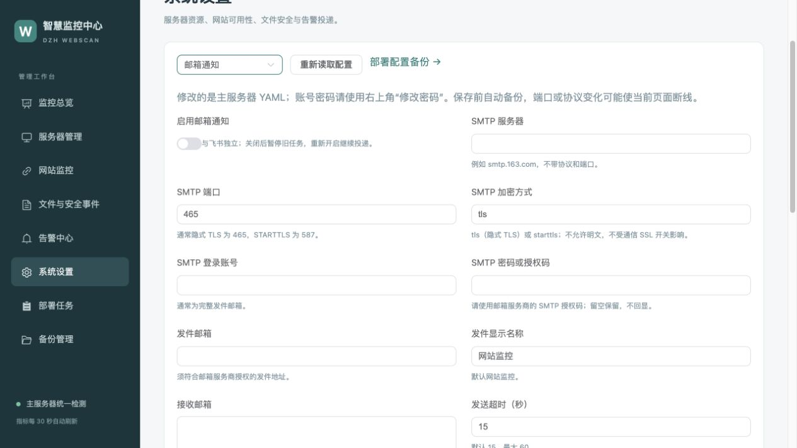

# 邮箱告警配置与投递历史

[返回 README](../README.md) · [后台操作](CONSOLE.md) · [配置参数](PARAMETERS.md)

v2.0.34 支持飞书和邮件同时通知。邮件默认关闭；不需要升级子服务器。绑定邮箱表示保存 SMTP 发件配置与接收列表，不读取收件箱。

## 后台配置

1. 进入 **系统设置 → 邮箱通知**，开启通知。
2. 填写邮箱服务商的 SMTP 主机、端口、登录账号、密码或授权码、发件地址。常见配置为端口 **465 + tls**，或 **587 + starttls**。
3. 接收邮箱每行一个，校验并去重后最多 20 个。配置通知类别、限流及重试。
4. 点击 **校验并预览变更 → 保存并应用**，等待部署任务成功。仅保存 YAML 时尚未生效。
5. 返回邮箱设置，核对“当前已应用收件人”，点击 **发送测试邮件**。确认收件对象后发送，在告警中心核对结果，并检查实际邮箱。

授权码隐藏输入，留空保留已有值。接口、预览和日志不会返回授权码。发件邮箱必须是服务商允许该账号使用的地址。SMTP 使用证书验证，不允许明文或 TLS 失败后降级；不受主子通信 SSL 总开关影响。

主服务器需要能**出站**连接 SMTP 端口；不需要开放新的入站端口。部分云平台限制 25 端口，推荐使用服务商支持的 465 或 587。

## YAML 示例

以下为示例，不含真实凭据；SH 和 Compose 使用同一配置：

```yaml
email:
  enabled: false
  smtp_host: smtp.example.com
  smtp_port: 465
  tls_mode: tls                     # tls / starttls
  username: sender@example.com
  password: ''                      # 开启时填写 SMTP 授权码
  from_address: sender@example.com
  from_name: 网站监控
  recipients:
    - receiver@example.com
  timeout_seconds: 15
  max_per_minute: 30
  retry:
    initial_delay_seconds: 30
    max_delay_seconds: 3600
  notifications:
    file_changes: true
    important_config_changes: true
    scan_matches: true
    scan_errors: true
    health_failures: true
    health_recoveries: true
```

升级旧 YAML 时邮件缺省关闭，初始通知类别沿用飞书类别；之后两通道独立修改。网站故障、证书、慢响应及资源／链路故障使用异常类别，恢复使用恢复类别。部署完成和管理员主动测试走专用通知；内部探针不生成业务邮件。

## 查看历史与排查

**告警中心 → 邮箱通知**：默认最近 24 小时、每页 20 条，可按服务器、收件人、状态、关键词和时间筛选。点击主题查看每个收件人的尝试次数、下一次重试和错误原因。最近 7 天图按收件人的投递结果统计。

| 状态 | 含义 |
|---|---|
| 待发送 | 尚未尝试 |
| 重试中 | 尝试失败，等待重试 |
| 部分成功 | 部分收件人已提交，其他仍待发送 |
| 已提交邮件服务器 | SMTP 服务确认接受全部收件人的邮件，不代表进入收件箱或已读 |
| 已暂停 | 邮件关闭，未完成任务保留 |

认证失败应检查授权码、SMTP 功能是否启用及账号；TLS 失败检查服务商主机、端口、加密方式和服务器时间；网络超时检查出站策略。接口仅显示脱敏原因。

飞书与邮件分别限流、重试，互不阻塞。每个收件人独立持久化，只重试失败者；同一收件人的恢复不会早于对应故障提交。任务入队固定收件列表，发送使用当前有效 SMTP 配置，修改接收列表不会改写旧任务。

关闭邮箱后旧任务暂停，开启后继续投递；积压数量见系统设置和主服务器详情的中心健康。旧历史不会在升级时补发邮件。看门狗在中心服务不可用时仍可用宿主机队列投递自身异常。重试使用稳定 Message-ID；SMTP 已接受但确认丢失时可能重复，不能保证绝对只收到一封。

## 升级与备份

```bash
webscan --upgrade --central-only
```

升级增量增加收件人及投递尝试表，已有账号、网站、故障、事件及飞书队列保留。首次迁移前创建 SQLite 一致性备份，备份失败停止迁移。邮件历史沿用通知保留期，纳入事件数据库的一致性备份；部署 YAML 备份含授权码，仅服务器本地受保护保存。


