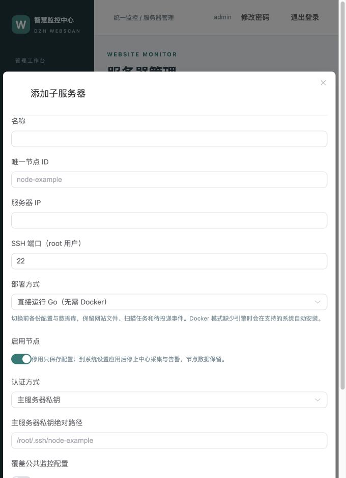

# 子服务器单服务部署（v2.0.35）

[返回 README](../README.md) · [后台使用](CONSOLE.md) · [安装](INSTALLATION.md) · [配置参数](PARAMETERS.md)

## 选择运行方式

| 方式 | 常驻程序 | 环境要求 |
|---|---|---|
| native，新增默认 | `webscan-agent-native.service` | root SSH、Linux amd64、systemd ≥ 231、CPU／内存 cgroup |
| docker | 一个 `webscan-agent` 容器 | Linux amd64、可用 Docker、Compose |

两种方式功能相同：文件监控、基线、安全扫描、SQLite 缓存、事件投递和主机指标。Go 按任务调用 YARA／ClamAV，扫描引擎仍保留。主服务器继续使用中心容器和宿主管理服务，需 Docker。

后台服务器管理 → 添加／编辑配置 → 选择部署方式 → 预览 → 保存并部署。列表与详情显示配置／实际方式、版本和部署阶段；仅保存时标记待应用。SH 向导也提供同样选择。

```yaml
node_defaults:
  deployment:
    mode: native
nodes:
  - id: node-example
    deployment:
      mode: docker
```

节点显式设置优先。旧 YAML 没有字段时，已部署节点沿用部署记录，旧三容器识别为 Docker；未部署节点默认 native。公共默认显式设为 native 会影响未单独指定的节点，批量切换前请检查预览。



## 无 Docker 的节点

native 全新节点不安装 Docker，通过 SSH 接收同版本程序和工具包。主服务器从已核验镜像提取包，验证外层 SHA256、包内清单、版本和扫描工具后，安装至 `/opt/webscan-go/releases/<版本>`。程序静态编译，不需要 Go、Python、Node.js 或 jq；扫描工具带独立加载器和依赖库。

需要 Bash、tar、sha256sum、常规 Linux 工具和可用资源控制能力。安装前留出工具包与两份一致性数据库备份空间（数据库大小的两倍，加至少 256 MiB）。不足、校验失败、扫描服务缺失均停止，不能继续关停旧服务。

Docker 模式复用正常引擎，不升级它。支持的全新 Debian／Ubuntu 按既有校验流程安装 Docker／Compose；已有 Docker 服务异常时停止报错，不重新安装，也不重启业务容器。不支持自动安装的系统请选择 native 或先手动安装 Docker。拉取镜像失败时可从主服务器经 SSH 传输已核验镜像。

ClamAV 默认规则依配置决定，开启后必须已有 `/run/clamav/clamd.ctl` 扫描服务。包只带客户端，不安装守护进程，也不静默关闭扫描。

## 端口与安全

| 方向 | 默认 TCP 端口 | 用途 |
|---|---|---|
| 主 → 子 | SSH，22 或配置端口 | 下发程序、配置与验收 |
| 主 → 子 | 19100 | `/metrics` 采集，仅允许配置来源与本机 |
| 子 → 主 | 19443 | 事件／receipts 接口，节点令牌认证 |

沿用原来源限制和统一 SSL 开关，不增加端口。HTTPS 指标启用双向 TLS，不跳过证书校验；HTTP 沿用来源限制。实际端口以当前有效配置为准，云安全组、宝塔防火墙和系统防火墙均需按方向放行。仅允许实际指标采集来源访问；无法确认来源时先检查，不猜测主机公网 IP。

native 用 systemd 强制内存、CPU、文件句柄限制，启动后核对实际属性。容器沿用内存和 CPU 限制；只读挂载宿主机 `/proc`、`/sys`、根目录，避免把容器网卡和磁盘当作宿主机。目录、配置、数据库及凭据继续 root 专用。

### 部署前提示与主动检测（v2.0.45）

服务器列表顶部和节点弹窗提供部署要求及当前端口。native 需要 systemd ≥231 和 CPU／内存 cgroup，监控目录必须存在可访问；启用 ClamAV 要有现成的 clamd 服务。空间检查计算数据库双份备份与程序预留需求，不自动删除业务数据。

保存并部署或独立升级前自动检查 SSH、环境和双向连接；指标端口空闲时短暂监听同版本 Go 检测程序，最长 90 秒，检测结束或断线清理。HTTPS 验证证书及双向 TLS。已有本项目服务直接检测，其他程序占用时停止部署。检测不会调整防火墙；超时需分别核对路由、来源限制、云安全组与系统规则。[流程、结果有效期与只读检查 →](DEPLOYMENT-WORKFLOW.md#部署前检查v2045)

## 数据与事件可靠性

Agent 事件先入 SQLite，再由一个工作器每批最多 100 条发送。中心事务保存，返回 accepted 后才确认；响应丢失会查询 receipts。保持原事件 ID，中心重复收到时去重。失败带抖动指数退避至最多 60 秒，重启继续处理。

永久拒绝事件留在失败记录中并告警，不阻塞后续正常事件。只清理已确认记录，容量和磁盘保护继续生效。旧 `vector_buffer_mib` 仅用于兼容配置，不控制新工作器；事件队列限制保持有效。

事件投递页面显示积压、最老等待和最近结果。原 Vector 历史及告警状态保持兼容，不重新创建一套故障记录。资源速率首样本、重启、计数重置显示未知，单项采集失败不会清空其他指标。

## 完整升级与方式切换

```bash
webscan --upgrade
```

中心先更新，再逐台更新启用节点。已有 Docker 节点合并为单容器，不自动改成 native；随后可以在后台逐台选择 native 并应用。`--central-only` 只升级中心，旧节点仍可采集，但尚未完成整合。

每个节点先准备目标文件与扫描预检查，再停止旧 Agent／Vector，保存一致性数据库、配置、服务与版本。保留并核对旧 JSONL，按原 ID 补入事件库。切换后验收指标、事件确认、监听覆盖与扫描，成功后旧服务不再自启动。

切换期间抑制当前维护节点的预期链路告警，其余节点继续监控。失败显示阶段、日志及原范围的恢复命令。不要修改任务版本或范围：

```bash
webscan --resume
webscan --rollback
```

回退先停止当前写入者，把切换后仍未确认事件按旧格式重新导出，再恢复旧服务；不使用旧数据库快照覆盖新事件。旧 Vector 缓冲、JSONL、镜像及日志保留，不解析 Vector 私有缓冲格式，也不全局清理 Docker。

主服务器 Go 一体化模式内部采集主机指标，验收通过后只停用本项目旧 host-exporter。中心 legacy 模式的历史迁移继续按 [迁移文档](MIGRATION.md) 完成，节点模式与中心模式独立。

## 手动包与故障排查

`cmd/compose` 为 Docker 节点生成单容器包，为 native 节点生成 systemd 安装包；只用于全新安装。已有节点升级与方式切换必须通过主服务器部署引擎。

- 指标缺失：先查看节点实际版本、采集器错误、19100 来源和证书，再查看服务日志。
- 投递积压：检查事件接口出站、节点认证、最近失败和 receipts；不要删除事件库或旧日志。
- native 启动失败：`systemctl status webscan-agent-native`、`journalctl -u webscan-agent-native`，检查扫描工具和 cgroup。
- 资源限制失败：部署会报错，确认 systemd/cgroup 配置后按日志恢复；不要用无硬限制服务绕过验收。
- 旧任务未完成：沿用原 YAML／版本／范围恢复，不并行启动第二个 Agent。
