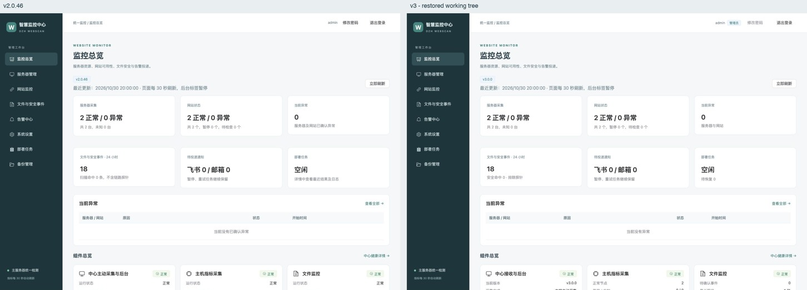

# v3 中心 UI 恢复与隔离验收

日期：2026-10-30。恢复基准：`v2.0.46`（`8422158e5cb454cf0b87b20f75351acc04192c86`）；工作区起点：`06e9ae0e57deb401e3b76e0a6172b1c70e944e9c`。UI 隔离验收阶段没有提交、推送、发布或切换生产入口，数据库、保留的旧主控数据及子服务器未被操作。随后用户授权提交并发布 v3.0.1；发布状态以该版本发布回执为准。

## 交付结论

已恢复旧版公共框架和主要页面结构：登录、侧栏与顶栏、单一主标题、统计卡、带图标组件卡、资源排名、列表列序、详情网格、资源曲线、页签、分类下拉、工具栏、深色部署日志及弹窗。数据始终由 v3 提供。**这不是旧版所有功能的完整等价交付**：下列尚无 v3 接口或证据的功能保持禁用／未知，不能因为页面外观恢复就认为这些功能已经开放。

[打开逐页图册](V3-UI-COMPARISON.html)。每张对照图左侧是 v2.0.46，右侧是当前 v3 工作区。

## 逐页结果与实际差异

| 区域 | 已恢复 | 保留的实际差异 / 限制 |
|---|---|---|
| 公共框架 | 原登录版式、字号、间距、侧栏图标、顶栏和标题 | 角色标签保留；修改密码入口禁用并提示使用管理命令，现有 v3 无公开改密写接口 |
| 总览 | 六卡、异常表、十三组件卡、三项排名、资源表 | PostgreSQL／VictoriaMetrics／主动采集按新架构显示；未接通的时序库健康、看门狗及自动完整备份证据仍显示未知，不复制旧版“正常” |
| 服务器 | 原列序、筛选、资源图、时间范围、页签与返回按钮 | 保留保存／下发／生效版本；未开放卸载接口禁用。只读查询提供汇总历史，磁盘／网卡设备历史选择器禁用；当前挂载点使用率仍可展示 |
| 添加与编辑 | 基本信息／部署方式／认证／文件监控分区、原按钮风格、正文滚动、固定反馈 | v3 必须填写节点与证书身份；目录和规则沿用受控配置包，本弹窗不新增规则写接口 |
| 网站 | 原列序、网址复制、证书有效期、详情网格、暂停／恢复、内嵌故障表 | 网站统计折叠；保留版本、迁移保护和现有软删除；没有新增网站历史响应曲线接口 |
| 文件事件 | 原筛选／刷新／表格／状态／详情结构 | 首次只显示查询条件；需手动查询，默认隐藏探针。原始载荷在详情折叠区，不当作主要内容；保留删除保护 |
| 告警 | 四页签、原表格和七日通知图 | 使用 v3 已支持的来源／阶段／状态筛选；不提供旧版接口未支持的任意全文／分类或收件人检索；通知详情仍限安全元数据 |
| 设置 | 原设置分类下拉、表单网格、操作附近反馈和预览弹窗 | 公共文件规则保留原字段结构，显示“未提供”且只读；已支持的网站、告警、通知字段沿用现有保存／应用。历史与备份、存储、审计按 v3 模型呈现；不新增删除按钮 |
| 部署 | 原任务列、阶段表、深色日志、搜索／仅看错误／自动滚动 | 保留现有准备、指纹、独立升级、继续／回退；仅展示实际日志阶段。当前无任务历史删除写接口，未仿造删除入口 |
| 备份 | 原网站／部署分类、工具栏、表格与弹窗 | 保留 v3 的加密存档、恢复预览和持久任务。配置恢复到“已保存、待应用”不宣称运行已切换 |
| 分页 | 原按钮／条数选择风格 | 20／50／100 条、上一页／下一页；保留服务端不透明游标，不显示虚构总数或任意跳页 |

## 对照方法

- 使用 `git archive v2.0.46 web` 提取基准，未编辑原版源码。
- `node scripts/verify-v3-ui.mjs` 启动两个仅回环可达的 Vite 服务。无生产代理、SSH、真实账号或通知通道。
- 相同合成节点、网站、资源值、事件和任务，固定样例时间 `2026-10-30T12:00:00Z`；按各版本真实接口转换为对应展示模型。不同架构的组件证据及尚未提供字段不会伪造一致。
- 桌面视口 1440×1000，手机视口 390×844。截图是完整长页；仅图册中的“首屏预览”裁取第一屏。原生滚动条被截图工具排除时仅补白，不缩放或修饰页面内容。
- 为稳定对照，仅测试夹具在两侧关闭 CSS／ECharts 动画；产品源码没有关闭动画。
- 共 24 组页面／状态、48 张桌面和手机成对图。所有主页面只有一个 h1；手机页面整体无横向溢出，宽表格内部横向滚动。添加弹窗在手机尺寸下正文可滚动、反馈及按钮留在视口内。

## 已验证行为

- 本地真实 Chrome：登录／退出、菜单、服务器与网站详情、资源／事件页签、筛选控件、条数选择样式、日志搜索和仅看错误；无浏览器控制台错误。
- 首次进入事件页面的 `/api/v3/events` 请求数为 0，手动点击查询后出现记录；最近 24 小时保护记录不可选择／删除。
- 编辑节点填写未保存草稿后点击独立升级：显示使用已保存配置的说明，确认合成预览后实际进入 `/deployments/job-a` 日志页面。夹具不执行 SSH 或安装。
- 真实文件选择读取专用合成文本文件，内容和换行一致；关闭并重开弹窗内容为空。文件拖入、空文件、超限、多文件、读取竞争和迟到读取由现有自动化测试覆盖。
- 挂载测试覆盖只读权限、详情返回与切换、筛选／分页不提交未保存条件、后台暂停与请求取消、旧响应不覆盖新页面、私钥及部署保护、日志续读和设置预览。保留删除逻辑。
- 请求记录验证恢复页只调用 `/api/v3`，无旧 `/api` 业务请求；匿名会话 401 属于登录流程的预期结果。

## 构建与测试

| 检查 | 结果 |
|---|---|
| 前端类型检查 | `npm --prefix web run typecheck` 通过 |
| 前端测试 | 25 个文件，220 项通过 |
| 前端构建 | `npm --prefix web run build` 通过；已生成内嵌 HTML 和带摘要资源 |
| Go 编译 | `go build -o .cache/ui-restoration-webscan ./cmd/webscan` 通过 |
| PostgreSQL／VictoriaMetrics 相关集成测试 | 真实隔离存储通过：安全投影、筛选、未知／零值、查询边界、通知计数与权限 |
| 相关 Go 竞争检查 | 16 项通过，`go test -race ./internal/controlplane -run 'TestConsole|TestNotificationHistory|TestDashboard|TestNodeRuntimeSavedDraft' -count=1`，webscan/internal/controlplane	24.828s |
| OpenAPI | YAML 解析通过，376 个本地 `$ref` 可解析 |
| 差异检查 | `git diff --check` 通过 |

完整本地日志位于 `.cache/ui-restoration-frontend-tests.log`、`.cache/ui-restoration-build.log`、`.cache/ui-restoration-go-race.log` 和 `.cache/ui-restoration-go-build.log`。真实 VM 测试先确认异步导入可见，再检查真实零值及断线缺口，避免首次空查询缓存影响结果。测试没有发送真实飞书或邮件。

## 源码与接口范围

- 页面和共享组件：`web/src/v3/`；原 `web/src` 的 v2 页面／样式未被改写。
- v3 客户端类型与只读方法：`web/src/controlV3.ts`。
- 安全读取投影、资源历史、通知统计：`internal/controlplane/console_servers.go`、`console_trends.go`、`console_notifications.go` 及现有查询路由。
- 只新增 `GET /api/v3/servers/:id/metrics`、`GET /api/v3/notifications/stats` 和兼容的列表／详情读取字段；不新增业务写接口，不开放任意探测或 PromQL。
- 曲线固定节点、来源及指标白名单，最大 31 天／1000 点、64 条时序、8 MiB 响应和 10 秒请求边界；缺失留空，真实零值保留。通知图仅返回七日聚合计数，不返回载荷或凭据。

## 全部对照图

| 页面 / 状态 | 桌面对照 | 手机对照 |
|---|---|---|
| 登录 | [查看](image/ui-restoration/login-desktop.jpg) | [查看](image/ui-restoration/login-mobile.jpg) |
| 监控总览 | [查看](image/ui-restoration/dashboard-desktop.jpg) | [查看](image/ui-restoration/dashboard-mobile.jpg) |
| 服务器列表 | [查看](image/ui-restoration/servers-desktop.jpg) | [查看](image/ui-restoration/servers-mobile.jpg) |
| 服务器资源详情 | [查看](image/ui-restoration/server-detail-desktop.jpg) | [查看](image/ui-restoration/server-detail-mobile.jpg) |
| 事件采集页签 | [查看](image/ui-restoration/server-health-desktop.jpg) | [查看](image/ui-restoration/server-health-mobile.jpg) |
| 添加子服务器弹窗 | [查看](image/ui-restoration/add-dialog-desktop.jpg) | [查看](image/ui-restoration/add-dialog-mobile.jpg) |
| 网站列表 | [查看](image/ui-restoration/websites-desktop.jpg) | [查看](image/ui-restoration/websites-mobile.jpg) |
| 网站详情 | [查看](image/ui-restoration/website-detail-desktop.jpg) | [查看](image/ui-restoration/website-detail-mobile.jpg) |
| 文件与安全事件 | [查看](image/ui-restoration/events-desktop.jpg) | [查看](image/ui-restoration/events-mobile.jpg) |
| 当前异常 | [查看](image/ui-restoration/alerts-desktop.jpg) | [查看](image/ui-restoration/alerts-mobile.jpg) |
| 告警历史 | [查看](image/ui-restoration/alerts-history-desktop.jpg) | [查看](image/ui-restoration/alerts-history-mobile.jpg) |
| 飞书通知 | [查看](image/ui-restoration/alerts-feishu-desktop.jpg) | [查看](image/ui-restoration/alerts-feishu-mobile.jpg) |
| 邮箱通知 | [查看](image/ui-restoration/alerts-email-desktop.jpg) | [查看](image/ui-restoration/alerts-email-mobile.jpg) |
| 公共监控设置 | [查看](image/ui-restoration/settings-desktop.jpg) | [查看](image/ui-restoration/settings-mobile.jpg) |
| 网站检测设置 | [查看](image/ui-restoration/settings-website-desktop.jpg) | [查看](image/ui-restoration/settings-website-mobile.jpg) |
| 飞书通知设置 | [查看](image/ui-restoration/settings-feishu-desktop.jpg) | [查看](image/ui-restoration/settings-feishu-mobile.jpg) |
| 邮箱通知设置 | [查看](image/ui-restoration/settings-email-desktop.jpg) | [查看](image/ui-restoration/settings-email-mobile.jpg) |
| 历史保留设置 | [查看](image/ui-restoration/settings-retention-desktop.jpg) | [查看](image/ui-restoration/settings-retention-mobile.jpg) |
| 存储与清理 | [查看](image/ui-restoration/settings-storage-desktop.jpg) | [查看](image/ui-restoration/settings-storage-mobile.jpg) |
| 操作审计 | [查看](image/ui-restoration/settings-audit-desktop.jpg) | [查看](image/ui-restoration/settings-audit-mobile.jpg) |
| 部署任务 | [查看](image/ui-restoration/deployments-desktop.jpg) | [查看](image/ui-restoration/deployments-mobile.jpg) |
| 部署详情及日志 | [查看](image/ui-restoration/deployment-detail-desktop.jpg) | [查看](image/ui-restoration/deployment-detail-mobile.jpg) |
| 网站配置备份 | [查看](image/ui-restoration/backups-desktop.jpg) | [查看](image/ui-restoration/backups-mobile.jpg) |
| 部署配置备份 | [查看](image/ui-restoration/config-backups-desktop.jpg) | [查看](image/ui-restoration/config-backups-mobile.jpg) |

## 后续上线边界

本地修改和验证完成后，仍需另行确认新补丁版本、构建中心镜像及线上更新。本轮没有执行这些操作。后续仅更新中心应用，保留 PostgreSQL、VictoriaMetrics、旧主控保留数据及子服务器状态；上述接口缺口也没有在本轮被假定完成。
